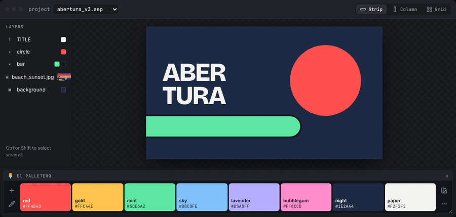
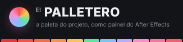
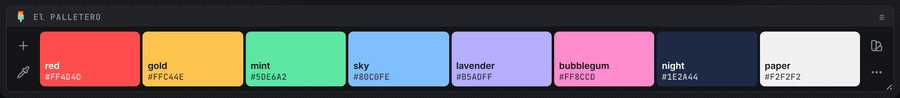
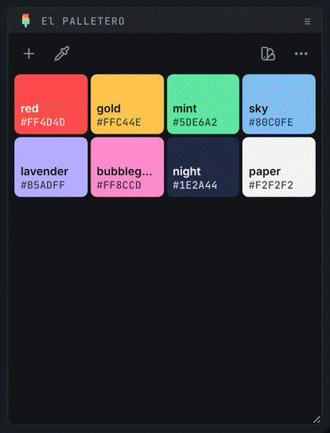
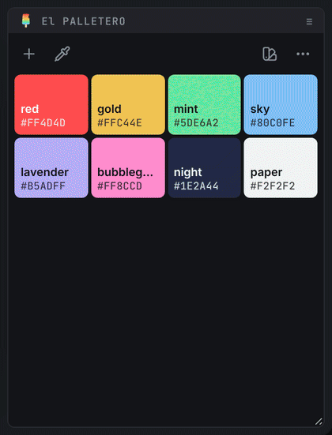
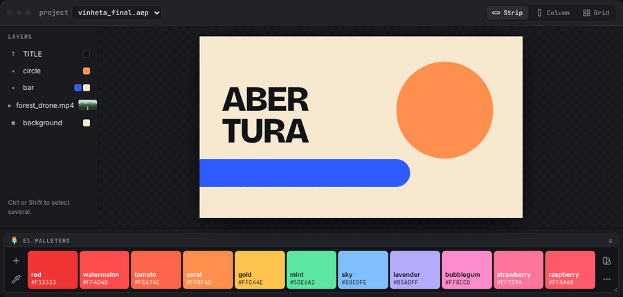
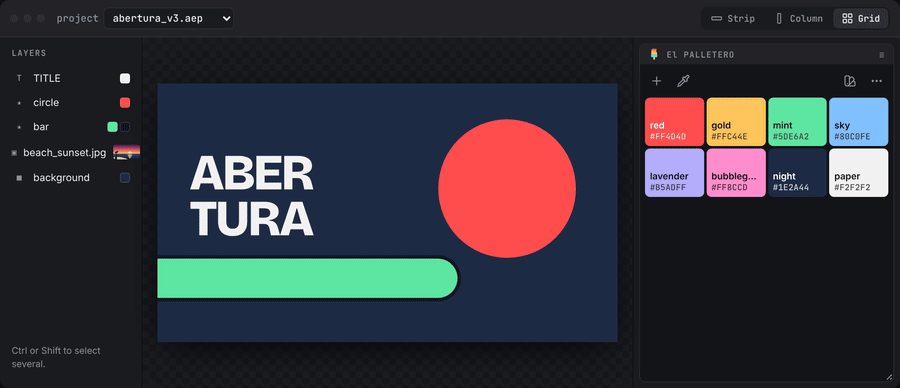
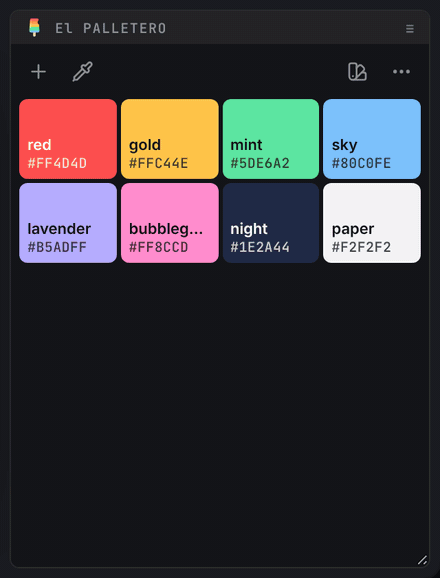
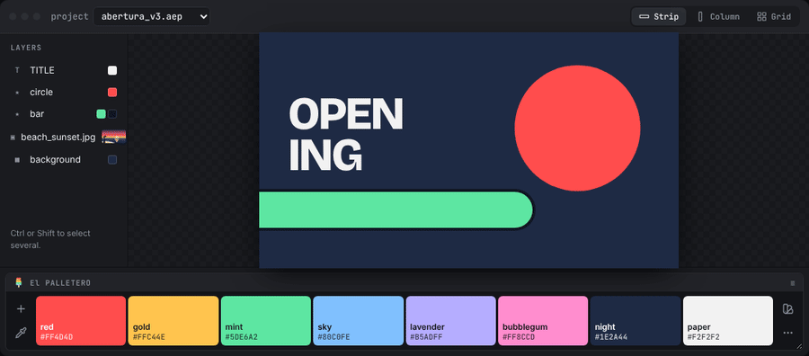

#  El PALLETERO · v1.5

🗨️ [português](README.md) · **English** · [español](README.es.md)

⚡ the project's color palette, as an After Effects panel ⚡

El PALLETERO keeps the project's colors in a panel you can dock anywhere in the interface. One click applies a color to the selected layers. Colors can come from the color picker, a harmony, the layers, the whole project, an image, pasted text, an `.ase` file or a preset library shared by the team.

> 

> 🧪 *want to try it without installing?* download [`mockup/El-PALLETERO-mockup.html`](mockup/El-PALLETERO-mockup.html) and open it in a browser (add `?lang=en` to the address for English). It runs the same code as the panel, wired to a fake composition. Every GIF on this page was recorded in it.

<br>

## 📍 contents

- [installation](#-installation)
- [coming from O PALETTERO](#-coming-from-o-palettero)
- [applying colors](#-applying-colors)
- [organizing the palette](#-organizing-the-palette)
- [color editor and automatic names](#-color-editor-and-automatic-names)
- [creating harmonies](#-creating-harmonies)
- [eyedropper](#-eyedropper)
- [extracting colors from an image](#-extracting-colors-from-an-image)
- [paste, import and export](#-paste-import-and-export)
- [presets](#-presets)
- [panel layouts](#-panel-layouts)
- [settings](#-settings)
- [languages](#-languages)
- [keyboard and shortcuts](#-keyboard-and-shortcuts)
- [development](#-development)

<br>

---

<br>

## 📍 installation

Requires After Effects **2022 (22.0)** or newer, on Windows or macOS.

> 

> 📂 **files:**\
> • **INSTALAR El PALLETERO.jsx** → installer (runs inside After Effects).\
> • **cep/com.jmbillard.elpalletero/** → the extension (CEP panel).\
> • **instalar_windows.bat** / **instalar_mac.command** → alternative installers that don't need After Effects.

1. In After Effects, go to `File` > `Scripts` > `Run Script File...` and pick **INSTALAR El PALLETERO.jsx** straight from the El PALLETERO folder (the one with the `cep` folder inside).
2. The installer checks what it needs. **If everything is fine, it opens straight at step 3** (the **back** button shows the checks). Otherwise it opens at the welcome screen and then shows the checks: 🟢 = ok, 🔴 = needs fixing. If file writing is blocked, use the **› open the Scripting & Expressions preferences** link, tick *Allow Scripts to Write Files and Access Network* and click **› check again**.
3. Choose **install** (or **update** / **reinstall** if a version is already on the computer; **remove** uninstalls). The screen shows where the extension is copied from and to.
4. Done! **Restart After Effects** and open the panel at `Window` > `Extensions` > `El PALLETERO`. Dock it wherever you like.

> 🚩 *notes:*\
> • Installation is **always local**: the whole extension is copied to the user's extensions folder. After that, El PALLETERO no longer depends on the source folder (network, USB stick or download). To update, run the installer of the new version.\
> • The extension is not signed, so the installer turns on CEP's `PlayerDebugMode` (versions 9 to 13).\
> • If the version with the old name (**O PALETTERO**) is installed, the installer replaces it. Palettes, presets and preferences are kept.\
> • **remove** deletes only the extension: palettes saved in projects and presets stay where they are.\
> • **Without After Effects:** double-click `instalar_windows.bat` (Windows) or `instalar_mac.command` (macOS). They do the same: copy the extension, replace the old version and turn on `PlayerDebugMode`.\
> • The installer speaks After Effects' language (Portuguese, English or Spanish; any other language gets English).\
> • **macOS:** if the panel doesn't show up after restarting After Effects, restart the computer.\
> • Preferences and presets live in `%APPDATA%\El PALLETERO\` (Windows) or `~/Library/Application Support/El PALLETERO/` (macOS).

<br>

---

<br>

## 📍 coming from O PALETTERO

The panel was called **O PALETTERO** up to v1.1. The first time El PALLETERO opens, it brings everything over from the old name:

| what | from | to |
| --- | --- | --- |
| preferences | `O PALETTERO script` folder | `El PALLETERO` folder |
| presets in the default folder | `O PALETTERO script/presets` | `El PALLETERO/presets` |
| custom presets folder (network) | stays the same | stays the same |
| each project's palette | O PALETTERO metadata | El PALLETERO metadata, on the first save |

> 🚩 *notes:*\
> • The old folder is **not deleted**: it is still the folder of the old O PALETTERO script, in case someone uses it.\
> • Just opening an old project changes nothing in it. The palette moves to the new format on the first change to the palette.\
> • The extension with the old name (`com.jmbillard.opalettero`) is removed by the [installer](#-installation), so there aren't two panels in the menu.\
> • Palettes saved by the old O PALETTERO script (`xmp:Label`) are read too and migrate on the first save.

<br>

---

<br>

## 📍 applying colors

1. Select the layers (or the color properties) in the composition.
2. `◖ left-click` the color.

- With **color properties selected** (Fill, Stroke, Tint, an effect's color, Source Text…), only they change.
- With a **group selected** (a shape's *Fill 1* or *Stroke 1*, a whole effect), the colors inside it change. In a shape group, a click paints the fills and `Shift` + click the strokes.
- With no properties selected, each layer gets a **Fill** effect named after the color (`#FF4D4D`). Applying another color **reuses** that Fill instead of stacking a new one.
- `Shift` + `◖ click` → **stroke**: paints the strokes of shape layers and the stroke of text (a text stroke gets 2 px if it was zero). Layers without a stroke show a message instead of getting a Fill. While `Shift` is held, the swatch's bucket turns into a ring.
- With keyframes, the color goes in at the current time.
- The last applied color gets a dot. With the accent in automatic mode, it also becomes the panel's accent color (see [settings](#-settings)).

With an empty palette, the panel offers ways to start: **capture**, **new color**, **presets**, **harmony**, or pasting colors.

> 🚩 *notes:*\
> • Each application is **one undo step** in After Effects (`El PALLETERO · apply #HEX`).\
> • With nothing selected, the swatch shakes and the message explains what's missing.

<br>

---

<br>

## 📍 organizing the palette

> 

- **drag** → reorders. Neighbors make room while you drag.
- `Ctrl` / `⌘` + `◖ click` → copies the color value (HEX, RGB or HSB, as set in settings).
- hold `Alt` / `⌥` → **delete mode**: swatches wiggle and show an ×. Click to remove.
- `◗ right-click` or ✏️ → color editor. The pencil sits in the swatch's corner: a small ring marks the spot and turns into the pencil when the mouse gets there (the bucket hides meanwhile).

> 🚩 *notes:*\
> • Every change to the palette can be **undone**: the button in the message, or `Ctrl+Z` / `⌘Z` with the panel focused.\
> • The palette is saved to the project right away. There is no save button.

<br>

---

<br>

## 📍 color editor and automatic names

The editor grows out of the swatch itself and goes back into it when you confirm.

> 

- **square** → saturation and brightness. **color strip** → hue. With the mouse or the arrow keys (`Shift` moves faster).
- **value field** → type or paste the color. The `HEX` button switches to `RGB` and `HSB`. Pasting anywhere in the editor works too (`#ff4d4d`, `rgb(255, 77, 77)`, `0 70 100`…).
- **left half of the preview** → the original color. `◖ click` goes back to it.
- `Enter` confirms, `Esc` cancels. 🗑️ deletes the color.
- The **wheel** button switches to the [harmony creator](#-creating-harmonies), starting from the editor's color.

### automatic names

Every color gets a real-world name, in the panel's language: *mint*, *brick*, *sky*, *mustard*, *eggplant*, *night*…

- The name is the one of the closest reference color (there are 133, compared in CIELAB, which measures color difference the way the eye does).
- If the name is already in the palette, a similar neighbor is used (*red* → *watermelon*), or *soft* / *deep*.
- In the editor, the automatic name (in italics, with a filled ✦) **follows the color** while you adjust it.
- Typed your own name? It stays fixed. ✦ brings the automatic one back.

> 🚩 *notes:*\
> • Old names like `cor 3`, empty names and names equal to the hex become automatic.\
> • To see names on the swatches, turn on **show names** in [settings](#-settings).

<br>

---

<br>

## 📍 creating harmonies

The editor's second mode: you choose a **base color** and a **rule**, and the sibling colors show up together. Open it from the wheel in the editor's footer; 💧 goes back to the single-color editor. **+** opens in the last mode used.

> 

- **wheel** → the angle is the hue and the distance from the center is the saturation. When space is tight it becomes a **square** (hue across, saturation up and down), with the same gestures.
  - drag **any point**: the whole set rotates together and the rule still holds.
  - clicking an empty spot moves the base color there.
  - with the wheel focused, ← → rotate (`Shift` rotates more) and ↑ ↓ change the saturation.
- **bar beside it** → brightness of all colors.
- **rules** (each icon is a mini wheel with the rule's points):

  | rule | colors |
  | --- | --- |
  | analogous | 5 neighbors on the wheel (with **spread**) |
  | monochromatic | 5 shades of the same color |
  | complementary | the base and its opposite |
  | split complementary | the base and the two neighbors of its opposite (with **spread**) |
  | triad | 3, 120° apart |
  | tetrad | 4, in a rectangle |
  | square | 4, 90° apart |

- **steps** → 1, 2 or 3 shades per color (light, the color, dark). Hidden for monochromatic, which is already made of shades.
- **generated colors** → `◖ click` leaves a color out (click again to bring it back). A wheel point fades when all of its colors are left out.
- **footer**:
  - 🔖 → saves the colors as a new **preset**, named after the rule and the base color (*mustard triad*).
  - ✓ → **adds** to the palette the colors that aren't there yet. The number in the corner counts them.
  - `Shift` + ✓ → **replaces** the palette.
  - `Enter` / `Shift+Enter` do the same; `Esc` cancels. Everything can be undone.

> 🚩 *note:* the rule, the spread and the steps are remembered for next time.

<br>

---

<br>

## 📍 eyedropper

The **eyedropper** (left dock) brings into the palette the colors already in the project, and understands what is selected:

| selection | the eyedropper | icon |
| --- | --- | --- |
| color properties | captures the colors of those properties | eyedropper |
| shape, text or solid layers | captures the layers' colors (effects, shapes, text, solids) | eyedropper |
| **image, video, PSD or precomp** layer | opens [color extraction from the image](#-extracting-colors-from-an-image) | image |
| nothing | extracts the colors of the **composition's current frame** | image |
| `Shift` + any selection | captures the colors of the **whole project** | layers |

On hover, the icon and the tooltip already show what the click will do.

> 

> 🚩 *notes:*\
> • Only colors not yet in the palette come in, and they arrive already named.\
> • The default red of effects that were never changed (`#FF0000`) is ignored.\
> • Want the colors of the **effects** on an image layer (a Tint, a Fill)? Select the properties: selected properties always take priority.\
> • With vector and image layers selected together, the vector layers' colors win.\
> • Layers with audio only don't count as images.

<br>

---

<br>

## 📍 extracting colors from an image

The **eyedropper**, with an image layer selected (or nothing selected), reads the current frame and suggests the main colors.

> 

- Works with **images**, **video**, **PSD** and **precomps**. With nothing selected, it uses the **composition's** current frame.
- The markers on the image show where each color came from. Hover a swatch to highlight its marker.
- `◖ click` a swatch → on / off.
- `−` / `+` → fewer or more colors (2 to 12; the panel remembers your choice).
- `◖ click` the image → adds the color at that spot (the loupe shows the color before you click). Transparent spots are ignored.
- ✓ or `Enter` → adds the colors that are on to the palette.

> 🚩 *notes:*\
> • Colors are grouped with **k-means in CIELAB**, and the panel picks groups that are clearly different from each other. The same image always gives the same result.\
> • Video and precomps need to be rendered. If it takes a while, *rendering frame · Ns* shows up. `Esc` cancels.\
> • The panel only reads the frame once the file has been completely written, and deletes the temporary files at the end.

<br>

---

<br>

## 📍 paste, import and export

- **paste** → with the panel focused, `Ctrl+V` / `⌘V` finds the colors in any copied text: `#hex` (3, 6 or 8 digits), `rgb()` / `rgba()`, `0xRRGGBB`, CSS, JSON, a Coolors URL (`coolors.co/264653-2a9d8f-…`) or a list of hex values. In CSS and JSON the name comes along (`--primary: #264653` → *primary*). Colors already in the palette are skipped. It can be undone.
- **import colors** (in [settings](#-settings)) → opens an `.ase` (Illustrator, Photoshop, InDesign: RGB, CMYK, Lab and gray) or any text file with colors (`.css`, `.scss`, `.json`, `.txt`, `.svg`…). The file's names become the colors' names.
- **export .ase** (in settings) → saves the project palette as an `.ase`, with the names, in a group named after the project. It opens in Illustrator, Photoshop and InDesign.

<br>

---

<br>

## 📍 presets

The project palette lives in the `.aep`. **Presets** are a library of palettes in a folder you choose, which can be the team's network folder.

> 

- `◖ click` a preset → **replaces** the project palette.
- `Shift` + `◖ click` → **adds** the missing colors.
- **project card** (the first one) → `◖ click` saves the palette as a new preset. When it changed since its source preset, `Shift` + `◖ click` updates that preset. A thin line sets the palette apart while it isn't saved.
- ✏️ renames, ★ sets the preset used in projects without a palette, 🗑️ deletes.
- To reorder, click the ⠿ handle to the right of the name, move and click again (or drag).
- 12 example palettes come included (Sunset, Ice cream parlor, Neon, Ocean, Forest, Earthy, Tropical, Retro 70s, City night, Brazil, Pastel, Monochrome), named in After Effects' language.

The presets folder understands Windows and Mac network paths, volumes mounted again (`VFX-1`) and unmounted volumes → [full documentation](docs/presets.en.md).

<br>

---

<br>

## 📍 panel layouts

The panel rearranges itself according to its size:

> 

| layout | when | what it looks like |
| --- | --- | --- |
| **strip** | wide and short | swatches side by side; the swatch under the mouse grows |
| **list** | narrow and tall | one color per row, with name and value |
| **grid** | roomy | square tiles; the editor and the extraction get more space |

<br>

---

<br>

## 📍 settings

**⋯** (right dock) opens the settings in place of the colors.

- **HEX · RGB · HSB** → format of the values on the swatches and of what is copied.
- 👁 **always show values** → shows the values without hovering (when they fit).
- 🏷 **show names** → shows the color name on the swatches.
- ⇅ **sort by hue** → follows the color wheel starting from the reds. Colors with a similar hue (up to 18° apart) stay together, from dark to light. Whites, grays and blacks, including slightly tinted ones, go to the end, also from dark to light.
- ⤓ **import colors** · ⤒ **export .ase** → see [paste, import and export](#-paste-import-and-export).
- 🗑 **hold to clear** → hold the button until the bar fills up to empty the palette (it can be undone).
- 🎨 **accent** → the interface's accent color (active buttons, outlines, focus). The first one, with the ring of colors, is **automatic**: the accent follows the last applied color (the dot in the middle shows which). The others set a fixed color.
- **language** → `PT · EN · ES`. Without a choice, the panel follows After Effects' language. See [languages](#-languages).
- At the end (on the right in the strip, at the bottom when vertical): ⌨ **shortcuts**, a sheet with every click and key (also `?` in the panel, `Esc` closes); **?** → this documentation, in the panel's language; and the version number.

<br>

---

<br>

## 📍 languages

The panel, After Effects (undo names, open/save dialogs, example presets), the installer and this documentation speak **Portuguese, English and Spanish**. So do the automatic color names: *menta* / *mint* / *menta*, *tijolo* / *brick* / *ladrillo*…

- **which language** → the one chosen in [settings](#-settings); without a choice, After Effects'. A language without a translation gets English.
- **switching** → in settings. The panel reloads right away (the palette lives in the project, nothing is lost). Automatic color names follow; names you typed stay as they are.

The translations live in two `.csv` files inside the extension (UTF-8, one column per language):

| file | contents |
| --- | --- |
| `cep/com.jmbillard.elpalletero/i18n/strings.csv` | all text: panel (`key,pt,en,es`), After Effects (`host.*`) and installer (`inst.*`) |
| `cep/com.jmbillard.elpalletero/i18n/colors.csv` | the reference colors for automatic names (`hex,pt,en,es`) |

- `{n}`, `{name}`… are replaced by the value; `.one` / `.other` are singular and plural; in the installer, `\n` is a line break.
- **new language** → add a column with the 2-letter code (`fr`, `de`, `it`…) **to both files**. It shows up in settings on its own. An empty cell uses the first column.
- After editing, `node tools/check-i18n.js` checks for missing or extra keys, empty cells and `{variables}` that differ between languages.

<br>

---

<br>

## 📍 keyboard and shortcuts

| action | Windows | macOS |
| --- | --- | --- |
| apply | `◖ click` | `◖ click` |
| apply to the stroke | `Shift` + `◖ click` | `⇧` + `◖ click` |
| edit | `◗ right-click` | `◗ right-click` or `Ctrl` + `◖ click` |
| copy value | `Ctrl` + `◖ click` | `⌘` + `◖ click` |
| delete | `Alt` + `◖ click` | `⌥` + `◖ click` |
| capture from the whole project | `Shift` + eyedropper | `⇧` + eyedropper |
| add a preset without replacing | `Shift` + `◖ click` on the preset | `⇧` + `◖ click` on the preset |
| harmony: replace the palette | `Shift` + ✓ or `Shift+Enter` | `⇧` + ✓ or `⇧Return` |
| undo (palette) | `Ctrl+Z` | `⌘Z` |
| paste colors | `Ctrl+V` | `⌘V` |
| shortcuts sheet | `?` | `?` |
| confirm / cancel (editor, extraction) | `Enter` / `Esc` | `Return` / `Esc` |
| focused swatch: apply · edit · delete | `Enter` · `F2` · `Delete` | `Return` · `F2` · `Delete` |

> 🚩 *notes:*\
> • While the panel is focused, it asks After Effects for these keys, so `Ctrl+Z` / `⌘Z` undoes the palette and not the project, and `Delete` doesn't delete layers.\
> • The icons show what they will do: the trash can opens its lid on hover (and opens more while you hold *clear*), the sort arrows swap places, ✓ draws itself, × spins, the eyedropper "sucks in" while capturing and the layers fan out with `Shift`.\
> • The panel's tooltips show up when the mouse can do something and change live while you hold `Ctrl`, `Alt` or `Shift`. Swatch tooltips go away after you've seen them a few times.

<br>

---

<br>

## 📍 development

```text
cep/com.jmbillard.elpalletero/
├── CSXS/manifest.xml   → extension registration (AEFT 22+)
├── index.html          → panel
├── css/panel.css       → look and animations
├── js/color.js         → color conversions (HSB, CIELAB…)
├── js/names.js         → automatic names
├── js/extract.js       → color extraction (k-means in CIELAB)
├── js/harmony.js       → harmony rules
├── js/io.js            → colors in pasted text and .ase files
├── js/i18n.js          → languages (reads i18n/*.csv)
├── js/bridge.js        → panel ↔ ExtendScript bridge (or the mock, in the browser)
├── js/panel.js         → state, interactions and animations
├── i18n/               → strings.csv and colors.csv: text and color names per language
└── jsx/host.jsx        → After Effects side: metadata, presets, network, apply, capture, frames, .ase
mockup/                 → demo page with a "fake After Effects"
tools/                  → scripts that build the mockup, the GIFs and the banner, and test the installer
INSTALAR El PALLETERO.jsx, instalar_mac.command, instalar_windows.bat → installers
```

- **debugging:** with the panel open, go to `http://localhost:8099` in Chrome.
- **mockup:** after changing the panel, run `node tools/build-mockup.js`. In the browser, `?lang=en` or `?lang=es` in the address opens the mockup in that language.
- **GIFs:** `node tools/gifs/record.js` re-records all of them from the mockup (or `node tools/gifs/record.js editor presets` for a few). With `--lang=en` or `--lang=es` it records into `docs/gifs/en/` or `docs/gifs/es/`, with the panel and the fake scene in that language. Needs Playwright and `ffmpeg`.
- **event log:** in settings (⋯), 3 clicks on the version number show live the mouse events that reach the panel. That's how we found that After Effects' CEP delivers `mousedown`/`mouseup` but not always `pointerdown`/`pointerup`: that's why every "press and drag" in the panel listens to both (`onPress` and `follow` in `panel.js`).
- **ExtendScript:** `node tools/check-es3.js` looks for ES3 reserved words in the `.jsx` files (After Effects rejects `native`, `int`, `class`, `char`… as variable names, even though Node accepts them). Run it before publishing a change to `host.jsx` or the installer.
- **languages:** `node tools/check-i18n.js` checks the translation `.csv` files against the code (missing or extra keys, empty cells, `{variables}`). The mockup embeds the `.csv` files; in After Effects the panel reads them from disk.
- **logo:** `docs/img/logo.svg` is the source. After changing the logo, run `node tools/installer/make-banner.js` (installer banner) and `node tools/installer/make-icons.js` (panel icons); the mockup and the empty-palette state use the same drawing.
- **installer:** `node tools/installer/test-installer.js` runs `INSTALAR El PALLETERO.jsx` in Node, with simulated File/Folder/ScriptUI (new install, old-name replacement, reinstall, remove, macOS, old AE and the languages). `node tools/installer/make-banner.js` builds the banner and writes it into the installer.
- The installers follow the model of [ABRIDOR](https://github.com/jmbillard/ABRIDOR).

> 🚩 *notes:*\
> • The panel uses CEP's Node.js (`--enable-nodejs`) to read the frame PNG, the language `.csv` files and the clipboard.\
> • The frame is generated with `saveFrameToPng`, a method that exists in After Effects but isn't in the official documentation.\
> • The installer banner reads "um projeto de paleta" (Portuguese for "a palette project"): it's part of the logo artwork.
