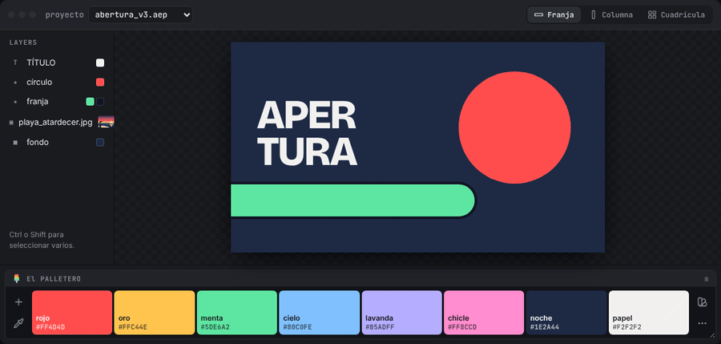
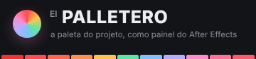
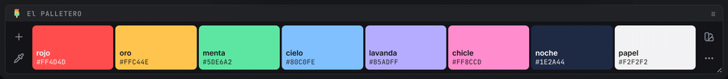
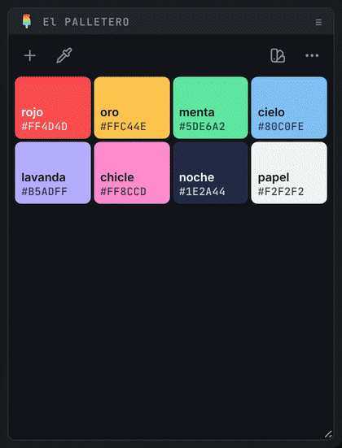
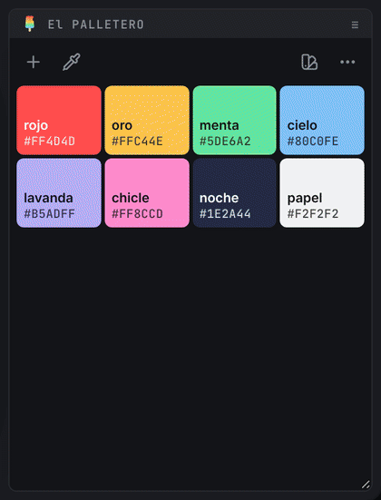
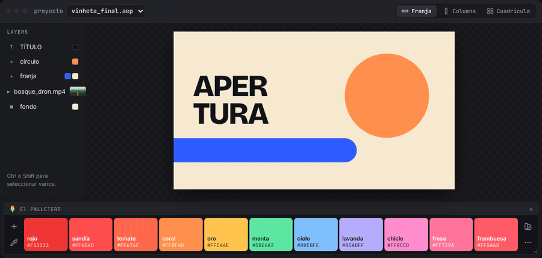
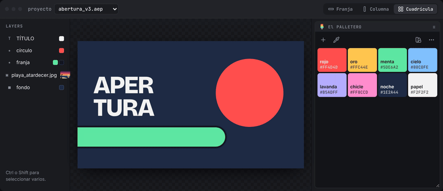
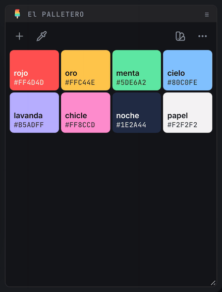
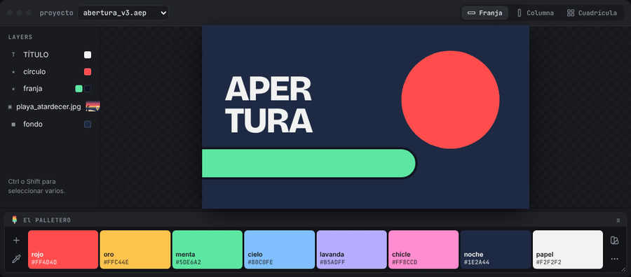

#  El PALLETERO · v1.5

🗨️ [português](README.md) · [English](README.en.md) · **español**

⚡ la paleta de colores del proyecto, como panel de After Effects ⚡

El PALLETERO guarda los colores del proyecto en un panel que puedes acoplar en cualquier parte de la interfaz. Un clic aplica el color a las capas seleccionadas. Los colores pueden venir del selector, de una armonía, de las capas, de todo el proyecto, de una imagen, de un texto pegado, de un `.ase` o de una biblioteca de presets compartida por el equipo.

> 

> 🧪 *¿quieres probarlo sin instalar?* descarga [`mockup/El-PALLETERO-mockup.html`](mockup/El-PALLETERO-mockup.html) y ábrelo en el navegador (añade `?lang=es` a la dirección para verlo en español). Es el mismo código del panel, conectado a una composición de mentira. Todos los GIF de esta página se grabaron en él.

<br>

## 📍 índice

- [instalación](#-instalación)
- [si vienes de O PALETTERO](#-si-vienes-de-o-palettero)
- [aplicar colores](#-aplicar-colores)
- [organizar la paleta](#-organizar-la-paleta)
- [editor de color y nombres automáticos](#-editor-de-color-y-nombres-automáticos)
- [crear armonías](#-crear-armonías)
- [cuentagotas](#-cuentagotas)
- [extraer colores de una imagen](#-extraer-colores-de-una-imagen)
- [pegar, importar y exportar](#-pegar-importar-y-exportar)
- [presets](#-presets)
- [formatos del panel](#-formatos-del-panel)
- [ajustes](#-ajustes)
- [idiomas](#-idiomas)
- [teclado y atajos](#-teclado-y-atajos)
- [desarrollo](#-desarrollo)

<br>

---

<br>

## 📍 instalación

Requiere After Effects **2022 (22.0)** o más reciente, en Windows o macOS.

> 

> 📂 **archivos:**\
> • **INSTALAR El PALLETERO.jsx** → instalador (se ejecuta dentro de After Effects).\
> • **cep/com.jmbillard.elpalletero/** → la extensión (panel CEP).\
> • **instalar_windows.bat** / **instalar_mac.command** → instaladores alternativos, sin abrir After Effects.

1. En After Effects, ve a `File` > `Scripts` > `Run Script File...` y elige **INSTALAR El PALLETERO.jsx** directamente desde la carpeta de El PALLETERO (la que tiene la carpeta `cep` dentro).
2. El instalador comprueba lo que necesita. **Si todo está bien, se abre directamente en el paso 3** (el botón **anterior** muestra la comprobación). Si no, se abre en la bienvenida y luego muestra la comprobación: 🟢 = ok, 🔴 = hay que resolverlo. Si la escritura de archivos está bloqueada, usa el enlace **› abrir las preferencias de scripts y expresiones**, marca *Allow Scripts to Write Files and Access Network* y haz clic en **› comprobar de nuevo**.
3. Elige **instalar** (o **actualizar** / **reinstalar** si ya hay una versión en el ordenador; **eliminar** la desinstala). La pantalla muestra desde dónde se copia la extensión y hacia dónde.
4. ¡Listo! **Reinicia After Effects** y abre el panel en `Window` > `Extensions` > `El PALLETERO`. Acóplalo donde prefieras.

> 🚩 *notas:*\
> • La instalación es **siempre local**: la extensión entera se copia a la carpeta de extensiones del usuario. Después, El PALLETERO ya no depende de la carpeta de origen (red, memoria USB o descarga). Para actualizar, ejecuta el instalador de la versión nueva.\
> • La extensión no está firmada, por eso el instalador activa el `PlayerDebugMode` de CEP (versiones 9 a 13).\
> • Si está instalada la versión con el nombre antiguo (**O PALETTERO**), el instalador la reemplaza. Se conservan las paletas, los presets y las preferencias.\
> • **eliminar** borra solo la extensión: las paletas guardadas en los proyectos y los presets siguen donde están.\
> • **Sin After Effects:** haz doble clic en `instalar_windows.bat` (Windows) o `instalar_mac.command` (macOS). Hacen lo mismo: copian la extensión, reemplazan la versión antigua y activan el `PlayerDebugMode`.\
> • El instalador habla el idioma de After Effects (portugués, inglés o español; cualquier otro idioma, inglés).\
> • **macOS:** si el panel no aparece después de reiniciar After Effects, reinicia el ordenador.\
> • Las preferencias y los presets están en `%APPDATA%\El PALLETERO\` (Windows) o `~/Library/Application Support/El PALLETERO/` (macOS).

<br>

---

<br>

## 📍 si vienes de O PALETTERO

El panel se llamaba **O PALETTERO** hasta la v1.1. La primera vez que se abre El PALLETERO, trae todo del nombre antiguo:

| qué | de | a |
| --- | --- | --- |
| preferencias | carpeta `O PALETTERO script` | carpeta `El PALLETERO` |
| presets de la carpeta predeterminada | `O PALETTERO script/presets` | `El PALLETERO/presets` |
| carpeta de presets personalizada (red) | sigue igual | sigue igual |
| paleta de cada proyecto | metadatos de O PALETTERO | metadatos de El PALLETERO, al guardar por primera vez |

> 🚩 *notas:*\
> • La carpeta antigua **no se borra**: sigue siendo la carpeta del antiguo script O PALETTERO, por si alguien lo usa.\
> • Solo abrir un proyecto antiguo no cambia nada en él. La paleta pasa al formato nuevo con el primer cambio en la paleta.\
> • La extensión con el nombre antiguo (`com.jmbillard.opalettero`) la elimina el [instalador](#-instalación), para que no haya dos paneles en el menú.\
> • Las paletas guardadas por el antiguo script O PALETTERO (`xmp:Label`) también se leen y migran al guardar por primera vez.

<br>

---

<br>

## 📍 aplicar colores

1. Selecciona las capas (o las propiedades de color) en la composición.
2. `◖ clic izquierdo` en el color.

- Con **propiedades de color seleccionadas** (Fill, Stroke, Tint, el color de un efecto, Source Text…), solo cambian ellas.
- Con un **grupo seleccionado** (el *Fill 1* o el *Stroke 1* de una forma, un efecto entero), cambian los colores dentro de él. En un grupo de forma, el clic pinta los rellenos y `Shift` + clic, los trazos.
- Sin propiedades seleccionadas, cada capa recibe un efecto **Fill** con el nombre del color (`#FF4D4D`). Aplicar otro color **reutiliza** ese Fill en vez de apilar otro.
- `Shift` + `◖ clic` → **contorno**: pinta los trazos (Stroke) de las capas de forma y el contorno de los textos (el contorno del texto pasa a 2 px si estaba en cero). Las capas sin trazo muestran un aviso en vez de recibir un Fill. Mientras mantienes `Shift`, el cubo de la muestra se convierte en un anillo.
- Con fotogramas clave, el color entra en el tiempo actual.
- El último color aplicado recibe un puntito. Con el acento en modo automático, también se convierte en el color de acento del panel (ver [ajustes](#-ajustes)).

Con la paleta vacía, el panel ofrece formas de empezar: **capturar**, **nuevo color**, **presets**, **armonía** o pegar colores.

> 🚩 *notas:*\
> • Cada aplicación es **un paso** de deshacer en After Effects (`El PALLETERO · aplicar #HEX`).\
> • Sin nada seleccionado, la muestra se sacude y el aviso explica lo que falta.

<br>

---

<br>

## 📍 organizar la paleta

> 

- **arrastrar** → reordena. Las vecinas hacen sitio mientras arrastras.
- `Ctrl` / `⌘` + `◖ clic` → copia el valor del color (HEX, RGB o HSB, según los ajustes).
- mantén `Alt` / `⌥` → **modo eliminar**: las muestras tiemblan y muestran una ×. Haz clic para quitarlas.
- `◗ clic derecho` o ✏️ → editor de color. El lápiz está en la esquina de la muestra: un pequeño anillo marca el sitio y se convierte en el lápiz cuando llega el ratón (el cubo desaparece mientras tanto).

> 🚩 *notas:*\
> • Todo cambio en la paleta se puede **deshacer**: con el botón del aviso o con `Ctrl+Z` / `⌘Z` con el panel en foco.\
> • La paleta se guarda en el proyecto al instante. No hay botón de guardar.

<br>

---

<br>

## 📍 editor de color y nombres automáticos

El editor nace de la propia muestra y vuelve a ella cuando confirmas.

> 

- **cuadrado** → saturación y brillo. **franja de colores** → matiz. Con el ratón o con las flechas del teclado (`Shift` avanza más rápido).
- **campo de valor** → escribe o pega el color. El botón `HEX` cambia a `RGB` y `HSB`. Pegar en cualquier parte del editor también funciona (`#ff4d4d`, `rgb(255, 77, 77)`, `0 70 100`…).
- **mitad izquierda de la vista previa** → el color original. `◖ clic` vuelve a él.
- `Enter` confirma, `Esc` cancela. 🗑️ elimina el color.
- El botón de la **rueda** cambia al [creador de armonías](#-crear-armonías), partiendo del color del editor.

### nombres automáticos

Cada color recibe un nombre del mundo real, en el idioma del panel: *menta*, *ladrillo*, *cielo*, *mostaza*, *berenjena*, *noche*…

- El nombre es el del color de referencia más cercano (son 133, comparados en CIELAB, que mide la diferencia de color como el ojo).
- Si el nombre ya está en la paleta, entra un vecino parecido (*rojo* → *sandía*) o *suave* / *intenso*.
- En el editor, el nombre automático (en cursiva, con ✦ relleno) **sigue al color** mientras lo ajustas.
- ¿Escribiste un nombre propio? Se queda fijo. ✦ devuelve el automático.

> 🚩 *notas:*\
> • Los nombres antiguos como `cor 3`, vacíos o iguales al hex se vuelven automáticos.\
> • Para ver los nombres en las muestras, activa **mostrar nombres** en los [ajustes](#-ajustes).

<br>

---

<br>

## 📍 crear armonías

El segundo modo del editor: eliges un **color base** y una **regla**, y los colores hermanos aparecen juntos. Se entra por la rueda en el pie del editor; 💧 vuelve al editor de un color. **+** abre en el último modo usado.

> 

- **rueda** → el ángulo es el matiz y la distancia al centro, la saturación. Con poco espacio se convierte en un **cuadrado** (matiz en horizontal, saturación en vertical), con los mismos gestos.
  - arrastra **cualquier punto**: todo el conjunto gira junto y la regla se mantiene.
  - hacer clic en un sitio vacío lleva el color base allí.
  - con la rueda en foco, ← → giran (`Shift` gira más) y ↑ ↓ cambian la saturación.
- **barra al lado** → brillo de todos los colores.
- **reglas** (cada icono es una mini rueda con los puntos de la regla):

  | regla | colores |
  | --- | --- |
  | análoga | 5 vecinos en el círculo (con **apertura**) |
  | monocromática | 5 tonos del mismo color |
  | complementaria | la base y su opuesto |
  | complementaria dividida | la base y los dos vecinos de su opuesto (con **apertura**) |
  | tríada | 3, a 120° |
  | tétrada | 4, en rectángulo |
  | cuadrado | 4, a 90° |

- **escalones** → 1, 2 o 3 tonos por color (claro, el color, oscuro). Desaparecen en la monocromática, que ya está hecha de tonos.
- **colores generados** → `◖ clic` deja un color fuera (otro clic lo trae de vuelta). Un punto de la rueda se atenúa cuando todos sus colores están fuera.
- **pie**:
  - 🔖 → guarda los colores como un **preset** nuevo, con el nombre de la regla y del color base (*tríada mostaza*).
  - ✓ → **añade** a la paleta los colores que aún no están. El número de la esquina los cuenta.
  - `Shift` + ✓ → **reemplaza** la paleta.
  - `Enter` / `Shift+Enter` hacen lo mismo; `Esc` cancela. Todo se puede deshacer.

> 🚩 *nota:* la regla, la apertura y los escalones se recuerdan para la próxima vez.

<br>

---

<br>

## 📍 cuentagotas

El **cuentagotas** (base izquierda) trae a la paleta los colores que ya están en el proyecto, y entiende lo que está seleccionado:

| selección | el cuentagotas | icono |
| --- | --- | --- |
| propiedades de color | captura los colores de esas propiedades | cuentagotas |
| capas de forma, texto o sólido | captura los colores de las capas (efectos, formas, textos, sólidos) | cuentagotas |
| capa de **imagen, vídeo, PSD o precomposición** | abre la [extracción de colores de la imagen](#-extraer-colores-de-una-imagen) | imagen |
| nada | extrae los colores del **fotograma actual de la composición** | imagen |
| `Shift` + cualquier selección | captura los colores de **todo el proyecto** | capas |

Al pasar el ratón, el icono y la sugerencia ya muestran lo que hará el clic.

> 

> 🚩 *notas:*\
> • Solo entran los colores que aún no están en la paleta, y llegan ya con nombre.\
> • Se ignora el rojo predeterminado de los efectos que nunca se cambiaron (`#FF0000`).\
> • ¿Quieres los colores de los **efectos** de una capa de imagen (un Tint, un Fill)? Selecciona las propiedades: las propiedades seleccionadas siempre tienen prioridad.\
> • Con capas vectoriales y de imagen seleccionadas juntas, cuentan los colores de las vectoriales.\
> • Las capas solo de audio no cuentan como imagen.

<br>

---

<br>

## 📍 extraer colores de una imagen

El **cuentagotas**, con una capa de imagen seleccionada (o nada seleccionado), lee el fotograma actual y sugiere los colores principales.

> 

- Funciona con **imagen**, **vídeo**, **PSD** y **precomposición**. Sin nada seleccionado, usa el fotograma actual de la **composición**.
- Los marcadores sobre la imagen muestran de dónde salió cada color. Pasa el ratón por una muestra para resaltar su marcador.
- `◖ clic` en una muestra → la activa / desactiva.
- `−` / `+` → menos o más colores (de 2 a 12; el panel recuerda tu elección).
- `◖ clic` en la imagen → añade el color de ese punto (la lupa muestra el color antes del clic). Los puntos transparentes se ignoran.
- ✓ o `Enter` → añade a la paleta los colores activados.

> 🚩 *notas:*\
> • Los colores se agrupan con **k-means en CIELAB**, y el panel elige grupos bien distintos entre sí. La misma imagen siempre da el mismo resultado.\
> • Los vídeos y las precomposiciones hay que renderizarlos. Si tarda, aparece *renderizando fotograma · Ns*. `Esc` cancela.\
> • El panel solo lee el fotograma cuando el archivo se ha guardado por completo, y borra los temporales al final.

<br>

---

<br>

## 📍 pegar, importar y exportar

- **pegar** → con el panel en foco, `Ctrl+V` / `⌘V` encuentra los colores en cualquier texto copiado: `#hex` (3, 6 u 8 dígitos), `rgb()` / `rgba()`, `0xRRGGBB`, CSS, JSON, la URL de Coolors (`coolors.co/264653-2a9d8f-…`) o una lista de hex. En CSS y JSON el nombre viene incluido (`--primario: #264653` → *primario*). Los colores que ya están en la paleta se omiten. Se puede deshacer.
- **importar colores** (en los [ajustes](#-ajustes)) → abre un `.ase` (Illustrator, Photoshop, InDesign: RGB, CMYK, Lab y gris) o cualquier archivo de texto con colores (`.css`, `.scss`, `.json`, `.txt`, `.svg`…). Los nombres del archivo pasan a ser los nombres de los colores.
- **exportar .ase** (en los ajustes) → guarda la paleta del proyecto como `.ase`, con los nombres, en un grupo con el nombre del proyecto. Se abre en Illustrator, Photoshop e InDesign.

<br>

---

<br>

## 📍 presets

La paleta del proyecto vive en el `.aep`. Los **presets** son una biblioteca de paletas en una carpeta que tú eliges, que puede ser una carpeta de red del equipo.

> 

- `◖ clic` en un preset → **reemplaza** la paleta del proyecto.
- `Shift` + `◖ clic` → **añade** los colores que faltan.
- **tarjeta del proyecto** (la primera) → `◖ clic` guarda la paleta como un preset nuevo. Si cambió desde su preset de origen, `Shift` + `◖ clic` actualiza ese preset. Una línea separa la paleta mientras no está guardada.
- ✏️ renombra, ★ define el preset usado en proyectos sin paleta, 🗑️ elimina.
- Para reordenar, haz clic en el asa ⠿ a la derecha del nombre, mueve y vuelve a hacer clic (o arrastra).
- Vienen 12 paletas de ejemplo (Atardecer, Heladería, Neón, Océano, Bosque, Terroso, Tropical, Retro 70, Noche urbana, Brasil, Pastel, Monocromático), con los nombres en el idioma de After Effects.

La carpeta de presets entiende rutas de red de Windows y Mac, volúmenes montados de nuevo (`VFX-1`) y volúmenes desmontados → [documentación completa](docs/presets.es.md).

<br>

---

<br>

## 📍 formatos del panel

El panel se reorganiza solo según su tamaño:

> 

| formato | cuándo | cómo queda |
| --- | --- | --- |
| **franja** | ancho y bajo | muestras una al lado de otra; la muestra bajo el ratón crece |
| **lista** | estrecho y alto | un color por fila, con nombre y valor |
| **cuadrícula** | amplio | bloques cuadrados; el editor y la extracción ganan espacio |

<br>

---

<br>

## 📍 ajustes

**⋯** (base derecha) abre los ajustes en lugar de los colores.

- **HEX · RGB · HSB** → formato de los valores en las muestras y de lo que se copia.
- 👁 **valores siempre visibles** → muestra los valores sin pasar el ratón (cuando caben).
- 🏷 **mostrar nombres** → muestra el nombre del color en las muestras.
- ⇅ **ordenar por matiz** → sigue el círculo de colores a partir de los rojos. Los colores de matiz parecido (hasta 18° de diferencia) quedan juntos, de oscuro a claro. Blancos, grises y negros, incluso los ligeramente teñidos, van al final, también de oscuro a claro.
- ⤓ **importar colores** · ⤒ **exportar .ase** → ver [pegar, importar y exportar](#-pegar-importar-y-exportar).
- 🗑 **mantén pulsado para vaciar** → mantén el botón hasta que se llene la barra para vaciar la paleta (se puede deshacer).
- 🎨 **color de acento** → el color de acento de la interfaz (botones activos, contornos, foco). El primero, con el anillo de colores, es el **automático**: el acento sigue al último color aplicado (el puntito del centro muestra cuál). Los demás fijan un color.
- **idioma** → `PT · EN · ES`. Sin elección, el panel sigue el idioma de After Effects. Ver [idiomas](#-idiomas).
- Al final (a la derecha en la franja, abajo en vertical): ⌨ **atajos**, una hoja con todos los clics y teclas (también con `?` en el panel, `Esc` la cierra); **?** → esta documentación, en el idioma del panel; y el número de versión.

<br>

---

<br>

## 📍 idiomas

El panel, After Effects (nombres del deshacer, ventanas de abrir/guardar, presets de ejemplo), el instalador y esta documentación hablan **portugués, inglés y español**. También los nombres automáticos de los colores: *menta* / *mint* / *menta*, *tijolo* / *brick* / *ladrillo*…

- **qué idioma** → el elegido en los [ajustes](#-ajustes); sin elección, el de After Effects. Un idioma sin traducción usa inglés.
- **cambiar** → en los ajustes. El panel se recarga al instante (la paleta está en el proyecto, no se pierde nada). Los nombres automáticos de los colores se adaptan; los nombres que escribiste se quedan como están.

Las traducciones están en dos `.csv` dentro de la extensión (UTF-8, una columna por idioma):

| archivo | contenido |
| --- | --- |
| `cep/com.jmbillard.elpalletero/i18n/strings.csv` | todos los textos: panel (`key,pt,en,es`), After Effects (`host.*`) e instalador (`inst.*`) |
| `cep/com.jmbillard.elpalletero/i18n/colors.csv` | los colores de referencia de los nombres automáticos (`hex,pt,en,es`) |

- `{n}`, `{name}`… se sustituyen por el valor; `.one` / `.other` son singular y plural; en el instalador, `\n` es un salto de línea.
- **idioma nuevo** → añade una columna con el código de 2 letras (`fr`, `de`, `it`…) **en los dos archivos**. Aparece sola en los ajustes. Una celda vacía usa la primera columna.
- Después de editar, `node tools/check-i18n.js` comprueba claves que faltan o sobran, celdas vacías y `{variables}` distintas entre idiomas.

<br>

---

<br>

## 📍 teclado y atajos

| acción | Windows | macOS |
| --- | --- | --- |
| aplicar | `◖ clic` | `◖ clic` |
| aplicar al contorno | `Shift` + `◖ clic` | `⇧` + `◖ clic` |
| editar | `◗ clic derecho` | `◗ clic derecho` o `Ctrl` + `◖ clic` |
| copiar valor | `Ctrl` + `◖ clic` | `⌘` + `◖ clic` |
| eliminar | `Alt` + `◖ clic` | `⌥` + `◖ clic` |
| capturar de todo el proyecto | `Shift` + cuentagotas | `⇧` + cuentagotas |
| añadir un preset sin reemplazar | `Shift` + `◖ clic` en el preset | `⇧` + `◖ clic` en el preset |
| armonía: reemplazar la paleta | `Shift` + ✓ o `Shift+Enter` | `⇧` + ✓ o `⇧Return` |
| deshacer (paleta) | `Ctrl+Z` | `⌘Z` |
| pegar colores | `Ctrl+V` | `⌘V` |
| hoja de atajos | `?` | `?` |
| confirmar / cancelar (editor, extracción) | `Enter` / `Esc` | `Return` / `Esc` |
| muestra en foco: aplicar · editar · eliminar | `Enter` · `F2` · `Delete` | `Return` · `F2` · `Delete` |

> 🚩 *notas:*\
> • Con el panel en foco, pide estas teclas a After Effects, para que `Ctrl+Z` / `⌘Z` deshaga la paleta y no el proyecto, y `Delete` no borre capas.\
> • Los iconos muestran lo que van a hacer: la papelera abre la tapa al pasar el ratón (y la abre más mientras mantienes *vaciar*), las flechas de ordenar cambian de sitio, ✓ se dibuja, × gira, el cuentagotas "aspira" mientras captura y las capas se abren con `Shift`.\
> • Las sugerencias del panel aparecen cuando el ratón puede hacer algo y cambian en vivo mientras mantienes `Ctrl`, `Alt` o `Shift`. Las sugerencias de las muestras desaparecen después de verlas algunas veces.

<br>

---

<br>

## 📍 desarrollo

```text
cep/com.jmbillard.elpalletero/
├── CSXS/manifest.xml   → registro de la extensión (AEFT 22+)
├── index.html          → panel
├── css/panel.css       → aspecto y animaciones
├── js/color.js         → conversiones de color (HSB, CIELAB…)
├── js/names.js         → nombres automáticos
├── js/extract.js       → extracción de colores (k-means en CIELAB)
├── js/harmony.js       → reglas de armonía
├── js/io.js            → colores en texto pegado y archivos .ase
├── js/i18n.js          → idiomas (lee i18n/*.csv)
├── js/bridge.js        → puente panel ↔ ExtendScript (o el mock, en el navegador)
├── js/panel.js         → estado, interacciones y animaciones
├── i18n/               → strings.csv y colors.csv: textos y nombres de color por idioma
└── jsx/host.jsx        → lado After Effects: metadatos, presets, red, aplicar, capturar, fotogramas, .ase
mockup/                 → página de demostración con un "After Effects de mentira"
tools/                  → scripts que generan el mockup, los GIF y el banner, y prueban el instalador
INSTALAR El PALLETERO.jsx, instalar_mac.command, instalar_windows.bat → instaladores
```

- **depurar:** con el panel abierto, abre `http://localhost:8099` en Chrome.
- **mockup:** después de cambiar el panel, ejecuta `node tools/build-mockup.js`. En el navegador, `?lang=en` o `?lang=es` en la dirección abre el mockup en ese idioma.
- **GIF:** `node tools/gifs/record.js` vuelve a grabarlos todos desde el mockup (o `node tools/gifs/record.js editor presets` para algunos). Con `--lang=en` o `--lang=es` graba en `docs/gifs/en/` o `docs/gifs/es/`, con el panel y la escena de mentira en ese idioma. Necesita Playwright y `ffmpeg`.
- **registro de eventos:** en los ajustes (⋯), 3 clics en el número de versión muestran en vivo los eventos de ratón que llegan al panel. Así descubrimos que el CEP de After Effects entrega `mousedown`/`mouseup`, pero no siempre `pointerdown`/`pointerup`: por eso todo "pulsar y arrastrar" del panel escucha los dos (`onPress` y `follow` en `panel.js`).
- **ExtendScript:** `node tools/check-es3.js` busca palabras reservadas de ES3 en los `.jsx` (After Effects rechaza `native`, `int`, `class`, `char`… como nombres de variable, aunque Node los acepte). Ejecútalo antes de publicar un cambio en `host.jsx` o en el instalador.
- **uso real:** `node tools/ux/journey.js` ejecuta una sesión de trabajo completa en el mockup, con los eventos de After Effects simulados (capturar, aplicar, editar, armonía, extraer, pegar, presets, teclado), y comprueba cada paso. `node tools/ux/sweep.js` captura cada pantalla en 8 tamaños de panel y señala botones fuera del panel o textos cortados (`PLANG=es` para otro idioma).
- **idiomas:** `node tools/check-i18n.js` comprueba los `.csv` de traducción contra el código (claves que faltan o sobran, celdas vacías, `{variables}`). El mockup incluye los `.csv`; en After Effects el panel los lee del disco.
- **logo:** `docs/img/logo.svg` es la fuente. Después de cambiar el logo, ejecuta `node tools/installer/make-banner.js` (banner del instalador) y `node tools/installer/make-icons.js` (iconos del panel); el mockup y el estado de paleta vacía usan el mismo dibujo.
- **instalador:** `node tools/installer/test-installer.js` ejecuta `INSTALAR El PALLETERO.jsx` en Node, con File/Folder/ScriptUI simulados (instalación nueva, cambio del nombre antiguo, reinstalar, eliminar, macOS, AE antiguo y los idiomas). `node tools/installer/make-banner.js` genera el banner y lo graba en el instalador.
- Los instaladores siguen el modelo de [ABRIDOR](https://github.com/jmbillard/ABRIDOR).

> 🚩 *notas:*\
> • El panel usa el Node.js de CEP (`--enable-nodejs`) para leer el PNG del fotograma, los `.csv` de idioma y el portapapeles.\
> • El fotograma se genera con `saveFrameToPng`, un método que existe en After Effects pero no está en la documentación oficial.\
> • El banner del instalador dice "um projeto de paleta" (en portugués, "un proyecto de paleta"): forma parte del dibujo del logo.
