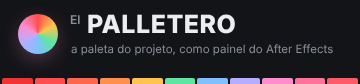
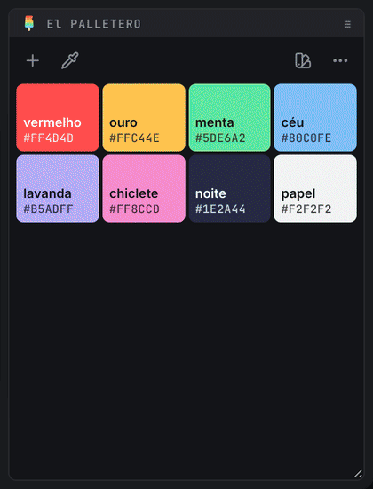

#  El PALLETERO · v1.5

🗨️ **português** · [English](README.en.md) · [español](README.es.md)

⚡ a paleta de cores do projeto, como painel do After Effects ⚡

o palletero guarda as cores do projeto num painel que você acopla em qualquer lugar da interface. um clique aplica a cor nos layers selecionados. as cores podem vir do seletor, de uma harmonia, dos layers, do projeto inteiro, de uma imagem, de um texto colado, de um `.ase` ou de uma biblioteca de presets compartilhada pela equipe.

> 

> 🧪 *quer experimentar sem instalar?* baixe [`mockup/El-PALLETERO-mockup.html`](mockup/El-PALLETERO-mockup.html) e abra no navegador: é o mesmo código do painel, ligado a uma composição de mentira. todos os GIFs desta página foram gravados nele.

<br>

## 📍 sumário

- [instalação](#-instalação)
- [vindo do O PALETTERO](#-vindo-do-o-palettero)
- [aplicar cores](#-aplicar-cores)
- [organizar a paleta](#-organizar-a-paleta)
- [editor de cor e nomes automáticos](#-editor-de-cor-e-nomes-automáticos)
- [criar harmonias](#-criar-harmonias)
- [conta-gotas](#-conta-gotas)
- [extrair cores de uma imagem](#-extrair-cores-de-uma-imagem)
- [colar, importar e exportar](#-colar-importar-e-exportar)
- [presets](#-presets)
- [formatos do painel](#-formatos-do-painel)
- [ajustes](#-ajustes)
- [idiomas](#-idiomas)
- [teclado e atalhos](#-teclado-e-atalhos)
- [desenvolvimento](#-desenvolvimento)

<br>

---

<br>

## 📍 instalação

requer After Effects **2022 (22.0)** ou mais novo, no Windows ou no macOS.

> 

> 📂 **arquivos:**\
> • **INSTALAR El PALLETERO.jsx** → instalador (roda dentro do After Effects).\
> • **cep/com.jmbillard.elpalletero/** → a extensão (painel CEP).\
> • **instalar_windows.bat** / **instalar_mac.command** → instaladores alternativos, sem abrir o After Effects.

1. no After Effects, abra `File` > `Scripts` > `Run Script File...` e escolha o **INSTALAR El PALLETERO.jsx** direto da pasta do El PALLETERO (a que tem a pasta `cep` dentro).
2. o instalador confere o que é necessário. **se estiver tudo certo, ele abre direto no passo 3** (o botão **anterior** mostra a checagem). senão, abre nas boas-vindas e depois mostra a checagem: bolinha 🟢 = ok, 🔴 = precisa resolver. se a escrita de arquivos estiver bloqueada, use o link **› abrir preferências de scripts e expressões**, marque *Allow Scripts to Write Files and Access Network* e clique em **› verificar de novo**.
3. escolha **instalar** (ou **atualizar** / **reinstalar**, se já houver uma versão no computador; **remover** desinstala). a tela mostra de onde a extensão vai ser copiada e para onde.
4. pronto! **reinicie o After Effects** e abra o painel em `Window` > `Extensions` > `El PALLETERO`. acople onde preferir.

> 🚩 *obs:*\
> • a instalação é **sempre local**: a extensão inteira é copiada para a pasta de extensões do usuário. depois disso o El PALLETERO não depende mais da pasta de origem (rede, pendrive ou download). para atualizar, rode o instalador da versão nova.\
> • a extensão não é assinada, por isso o instalador habilita o `PlayerDebugMode` do CEP (versões 9 a 13).\
> • se a versão com o nome antigo (**O PALETTERO**) estiver instalada, o instalador troca pela nova. paletas, presets e preferências são mantidos.\
> • **remover** apaga só a extensão: as paletas salvas nos projetos e os presets continuam onde estão.\
> • **sem o After Effects:** dê dois cliques em `instalar_windows.bat` (Windows) ou `instalar_mac.command` (macOS). fazem o mesmo: copiam a extensão, trocam a versão antiga e habilitam o `PlayerDebugMode`.\
> • o instalador fala o idioma do After Effects (português, inglês ou espanhol; outros idiomas, inglês).\
> • **macOS:** se o painel não aparecer depois de reiniciar o After Effects, reinicie o computador.\
> • as preferências e os presets ficam em `%APPDATA%\El PALLETERO\` (Windows) ou `~/Library/Application Support/El PALLETERO/` (macOS).

<br>

---

<br>

## 📍 vindo do O PALETTERO

o painel se chamava **O PALETTERO** até a v1.1. na primeira vez que o El PALLETERO abre, ele traz tudo do nome antigo:

| o quê | de | para |
| --- | --- | --- |
| preferências | pasta `O PALETTERO script` | pasta `El PALLETERO` |
| presets da pasta padrão | `O PALETTERO script/presets` | `El PALLETERO/presets` |
| pasta de presets personalizada (rede) | continua a mesma | continua a mesma |
| paleta de cada projeto | metadados do O PALETTERO | metadados do El PALLETERO, no primeiro salvamento |

> 🚩 *obs:*\
> • a pasta antiga **não é apagada**: ela ainda é a pasta do antigo script O PALETTERO, caso alguém use.\
> • só abrir um projeto antigo não altera nada nele. a paleta passa para o formato novo na primeira mudança na paleta.\
> • a extensão com o nome antigo (`com.jmbillard.opalettero`) é removida pelo [instalador](#-instalação), para não ficarem dois painéis no menu.\
> • paletas salvas pelo antigo script O PALETTERO (`xmp:Label`) também são lidas e migram no primeiro salvamento.

<br>

---

<br>

## 📍 aplicar cores

1. selecione os layers (ou as propriedades de cor) na composição.
2. `◖ clique esquerdo` na cor.

- com **propriedades de cor selecionadas** (Fill, Stroke, Tint, a cor de um efeito, o Source Text…), só elas mudam.
- com um **grupo selecionado** (o *Fill 1* ou o *Stroke 1* de um shape, um efeito inteiro), mudam as cores de dentro dele. num grupo de shape, o clique pinta os preenchimentos e `Shift` + clique, os traços.
- sem propriedades selecionadas, cada layer ganha um efeito **Fill** com o nome da cor (`#FF4D4D`). aplicar outra cor **reaproveita** esse Fill em vez de empilhar outro.
- `Shift` + `◖ clique` → **contorno**: pinta os traços (Stroke) dos shape layers e o contorno dos textos (o contorno do texto ganha 2 px se estava em zero). layers sem traço avisam em vez de ganhar um Fill. com o `Shift` seguro, o balde da amostra vira um anel.
- com keyframes, a cor entra no tempo atual.
- a última cor aplicada ganha um pontinho. com o destaque no modo automático, ela também vira a cor de destaque do painel (veja [ajustes](#-ajustes)).

com a paleta vazia, o painel oferece os caminhos para começar: **capturar**, **nova cor**, **presets**, **harmonia**, ou colar cores.

> 🚩 *obs:*\
> • cada aplicação é **um passo** de desfazer no After Effects (`El PALLETERO · aplicar #HEX`).\
> • sem nada selecionado, a amostra balança e o aviso explica o que falta.

<br>

---

<br>

## 📍 organizar a paleta

> 

- **arrastar** → reordena. os vizinhos abrem espaço enquanto você arrasta.
- `Ctrl` / `⌘` + `◖ clique` → copia o valor da cor (HEX, RGB ou HSB, conforme os ajustes).
- segure `Alt` / `⌥` → **modo excluir**: as amostras tremem e mostram um ×. clique para remover.
- `◗ clique direito` ou o ✏️ → editor de cor. o lápis fica no canto da amostra: uma argolinha marca o lugar e vira o lápis quando o mouse chega lá (o balde some enquanto isso).

> 🚩 *obs:*\
> • toda mudança na paleta tem **desfazer**: o botão no aviso ou `Ctrl+Z` / `⌘Z` com o painel em foco.\
> • a paleta é salva no projeto na hora. não existe botão de salvar.

<br>

---

<br>

## 📍 editor de cor e nomes automáticos

o editor nasce da própria amostra e volta para ela quando você confirma.

> 

- **quadrado** → saturação e brilho. **faixa colorida** → matiz. com o mouse ou com as setas do teclado (`Shift` anda mais rápido).
- **campo de valor** → digite ou cole a cor. o botão `HEX` alterna para `RGB` e `HSB`. colar em qualquer lugar do editor também funciona (`#ff4d4d`, `rgb(255, 77, 77)`, `0 70 100`…).
- **metade esquerda da prévia** → a cor original. `◖ clique` volta para ela.
- `Enter` confirma, `Esc` cancela. o 🗑️ exclui a cor.
- o botão da **roda** troca para o [criador de harmonias](#-criar-harmonias), partindo da cor do editor.

### nomes automáticos

cada cor ganha um nome do mundo real, no idioma do painel: *menta*, *tijolo*, *céu*, *mostarda*, *berinjela*, *noite*…

- o nome é o da cor de referência mais próxima (são 133, comparadas em CIELAB, que mede diferença de cor como o olho).
- se o nome já existe na paleta, entra um vizinho parecido (*vermelho* → *melancia*) ou *suave* / *forte*.
- no editor, o nome automático (em itálico, com ✦ preenchido) **acompanha a cor** enquanto você mexe.
- digitou um nome seu? ele fica fixo. o ✦ devolve o automático.

> 🚩 *obs:*\
> • nomes antigos como `cor 3`, vazios ou iguais ao hex viram automáticos.\
> • para ver os nomes nas amostras, ligue **mostrar nomes** nos [ajustes](#-ajustes).

<br>

---

<br>

## 📍 criar harmonias

o segundo modo do editor: você escolhe uma **cor base** e uma **regra**, e as cores irmãs aparecem juntas. entra pela roda no rodapé do editor; o 💧 volta para o editor de uma cor. o **+** abre no último modo usado.

> 

- **roda** → o ângulo é o matiz e a distância do centro é a saturação. com pouco espaço ela vira um **quadrado** (matiz na horizontal, saturação na vertical), com os mesmos gestos.
  - arraste **qualquer ponto**: o conjunto inteiro gira junto e a regra continua valendo.
  - clicar num lugar vazio leva a cor base até lá.
  - com a roda em foco, ← → giram (`Shift` gira mais) e ↑ ↓ mudam a saturação.
- **barra ao lado** → brilho de todas as cores.
- **regras** (cada ícone é uma mini-roda com os pontos da regra):

  | regra | cores |
  | --- | --- |
  | análoga | 5 vizinhas no círculo (com **abertura**) |
  | monocromática | 5 tons da mesma cor |
  | complementar | a base e a oposta |
  | complementar dividida | a base e as duas vizinhas da oposta (com **abertura**) |
  | tríade | 3, a 120° |
  | tétrade | 4, em retângulo |
  | quadrado | 4, a 90° |

- **degraus** → 1, 2 ou 3 tons por cor (claro, a cor, escuro). somem na monocromática, que já é feita de tons.
- **cores geradas** → `◖ clique` deixa uma cor de fora (e de novo traz de volta). o ponto da roda esmaece quando todas as cores dele estão de fora.
- **rodapé**:
  - 🔖 → salva as cores como um **preset** novo, com o nome da regra e da cor base (*tríade mostarda*).
  - ✓ → **adiciona** à paleta as cores que ainda não estão lá. o número no canto conta quantas são.
  - `Shift` + ✓ → **substitui** a paleta.
  - `Enter` / `Shift+Enter` fazem o mesmo; `Esc` cancela. tudo tem desfazer.

> 🚩 *obs:* a regra, a abertura e os degraus ficam guardados para a próxima vez.

<br>

---

<br>

## 📍 conta-gotas

o **conta-gotas** (doca da esquerda) traz para a paleta as cores que já estão no projeto, e entende o que está selecionado:

| seleção | o conta-gotas | ícone |
| --- | --- | --- |
| propriedades de cor | captura as cores dessas propriedades | conta-gotas |
| layers de shape, texto ou sólido | captura as cores dos layers (efeitos, shapes, textos, sólidos) | conta-gotas |
| layer de **imagem, vídeo, PSD ou precomp** | abre a [extração de cores da imagem](#-extrair-cores-de-uma-imagem) | imagem |
| nada | extrai as cores do **frame atual da composição** | imagem |
| `Shift` + qualquer seleção | captura as cores do **projeto inteiro** | camadas |

ao passar o mouse, o ícone e a dica já mostram o que o clique vai fazer.

> 

> 🚩 *obs:*\
> • só entram cores que ainda não estão na paleta, e já chegam com nome.\
> • o vermelho padrão de efeitos que nunca foram alterados (`#FF0000`) é ignorado.\
> • quer as cores dos **efeitos** de um layer de imagem (um Tint, um Fill)? selecione as propriedades: propriedades selecionadas sempre têm prioridade.\
> • com layers vetoriais e de imagem selecionados juntos, valem as cores dos vetoriais.

<br>

---

<br>

## 📍 extrair cores de uma imagem

o **conta-gotas**, com um layer de imagem selecionado (ou nada selecionado), lê o frame atual e sugere as cores principais.

> 

- funciona com **imagem**, **vídeo**, **PSD** e **precomp**. sem nada selecionado, usa o frame atual da **composição**.
- os marcadores na imagem mostram de onde veio cada cor. passe o mouse numa amostra para destacar o marcador.
- `◖ clique` numa amostra → liga / desliga.
- `−` / `+` → menos ou mais cores (de 2 a 12; o painel lembra a sua escolha).
- `◖ clique` na imagem → adiciona a cor daquele ponto (a lupa mostra a cor antes do clique). pontos transparentes são ignorados.
- ✓ ou `Enter` → adiciona as cores ligadas à paleta.

> 🚩 *obs:*\
> • as cores são agrupadas por **k-means em CIELAB**, e o painel escolhe grupos bem diferentes entre si. a mesma imagem sempre dá o mesmo resultado.\
> • vídeos e precomps precisam ser renderizados. se demorar, aparece *renderizando frame · Ns*. `Esc` cancela.\
> • o painel só lê o frame depois que o arquivo foi gravado por completo, e apaga os temporários no final.

<br>

---

<br>

## 📍 colar, importar e exportar

- **colar** → com o painel em foco, `Ctrl+V` / `⌘V` acha as cores em qualquer texto copiado: `#hex` (3, 6 ou 8 dígitos), `rgb()` / `rgba()`, `0xRRGGBB`, CSS, JSON, a URL do Coolors (`coolors.co/264653-2a9d8f-…`) ou uma lista de hex. em CSS e JSON o nome vem junto (`--primaria: #264653` → *primaria*). cores que já estão na paleta ficam de fora. tem desfazer.
- **importar cores** (nos [ajustes](#-ajustes)) → abre um `.ase` (Illustrator, Photoshop, InDesign: RGB, CMYK, Lab e cinza) ou qualquer arquivo de texto com cores (`.css`, `.scss`, `.json`, `.txt`, `.svg`…). os nomes do arquivo viram os nomes das cores.
- **exportar .ase** (nos ajustes) → grava a paleta do projeto como `.ase`, com os nomes, num grupo com o nome do projeto. abre no Illustrator, no Photoshop e no InDesign.

<br>

---

<br>

## 📍 presets

a paleta do projeto mora no `.aep`. os **presets** são uma biblioteca de paletas numa pasta que você escolhe, que pode ser uma pasta de rede da equipe.

> 

- `◖ clique` num preset → **substitui** a paleta do projeto.
- `Shift` + `◖ clique` → **adiciona** as cores que faltam.
- **cartão do projeto** (o primeiro) → `◖ clique` salva a paleta como preset novo. quando ela mudou desde o preset de origem, `Shift` + `◖ clique` atualiza aquele preset. um fio separa a paleta quando ela ainda não está salva.
- ✏️ renomeia, ★ define o preset usado em projetos sem paleta, 🗑️ exclui.
- para reordenar, clique na alça ⠿ à direita do nome, mova e clique de novo (ou arraste).
- já vêm 12 paletas de exemplo (Pôr do sol, Sorveteria, Neon, Oceano, Floresta, Terroso, Tropical, Retrô 70, Noite urbana, Brasil, Pastel, Monocromático).

a pasta de presets entende caminhos de rede do Windows e do Mac, volumes montados de novo (`VFX-1`) e volumes desmontados → [documentação completa](docs/presets.md).

<br>

---

<br>

## 📍 formatos do painel

o painel se reorganiza sozinho conforme o tamanho:

> 

| formato | quando | como fica |
| --- | --- | --- |
| **faixa** | largo e baixo | amostras lado a lado; a amostra sob o mouse cresce |
| **lista** | estreito e alto | uma cor por linha, com nome e valor |
| **grade** | espaçoso | blocos quadrados; o editor e a extração ganham espaço |

<br>

---

<br>

## 📍 ajustes

o **⋯** (doca da direita) abre os ajustes no lugar das cores.

- **HEX · RGB · HSB** → formato dos valores nas amostras e do que é copiado.
- 👁 **valores sempre visíveis** → mostra os valores sem precisar passar o mouse (quando cabem).
- 🏷 **mostrar nomes** → mostra o nome da cor nas amostras.
- ⇅ **ordenar por matiz** → segue o círculo de cores a partir dos vermelhos. cores de matiz parecido (até 18° de diferença) ficam juntas, do escuro ao claro. brancos, cinzas e pretos, inclusive os levemente tingidos, vão para o fim, também do escuro ao claro.
- ⤓ **importar cores** · ⤒ **exportar .ase** → veja [colar, importar e exportar](#-colar-importar-e-exportar).
- 🗑 **segure para limpar** → segure o botão até a barra encher para esvaziar a paleta (tem desfazer).
- ⌨ **atalhos** → uma folha com todos os cliques e teclas (também com `?` no painel). `Esc` fecha.
- 🎨 **destaque** → a cor de destaque da interface (botões ligados, contornos, foco). o primeiro, com o anel de cores, é o **automático**: o destaque acompanha a última cor aplicada (a bolinha do meio mostra qual). as outras deixam uma cor fixa.
- **idioma** → `PT · EN · ES`. sem escolha, o painel segue o idioma do After Effects. veja [idiomas](#-idiomas).
- no fim (à direita na faixa, embaixo na vertical): ⌨ **atalhos**, **?** → esta documentação, no idioma do painel, e o número da versão.

<br>

---

<br>

## 📍 idiomas

o painel, o After Effects (nomes do desfazer, janelas de abrir/salvar, presets de exemplo), o instalador e esta documentação falam **português, inglês e espanhol**. os nomes automáticos das cores também: *menta* / *mint* / *menta*, *tijolo* / *brick* / *ladrillo*…

- **qual idioma** → o escolhido nos [ajustes](#-ajustes); sem escolha, o do After Effects. idioma sem tradução usa inglês.
- **trocar** → nos ajustes. o painel recarrega na hora (a paleta está no projeto, nada se perde). nomes automáticos das cores acompanham; nomes que você digitou ficam como estão.

as traduções ficam em dois `.csv` dentro da extensão (UTF-8, uma coluna por idioma):

| arquivo | o que tem |
| --- | --- |
| `cep/com.jmbillard.elpalletero/i18n/strings.csv` | todos os textos: painel (`chave,pt,en,es`), After Effects (`host.*`) e instalador (`inst.*`) |
| `cep/com.jmbillard.elpalletero/i18n/colors.csv` | as cores de referência dos nomes automáticos (`hex,pt,en,es`) |

- `{n}`, `{name}`… são trocados pelo valor; `.one` / `.other` são singular e plural; no instalador, `\n` é quebra de linha.
- **idioma novo** → acrescente uma coluna com o código de 2 letras (`fr`, `de`, `it`…) **nos dois arquivos**. ele aparece sozinho nos ajustes. célula vazia usa a primeira coluna.
- depois de editar, `node tools/check-i18n.js` confere chaves faltando ou sobrando, células vazias e `{variáveis}` diferentes entre idiomas.

<br>

---

<br>

## 📍 teclado e atalhos

| ação | Windows | macOS |
| --- | --- | --- |
| aplicar | `◖ clique` | `◖ clique` |
| aplicar no contorno | `Shift` + `◖ clique` | `⇧` + `◖ clique` |
| editar | `◗ clique direito` | `◗ clique direito` ou `Ctrl` + `◖ clique` |
| copiar valor | `Ctrl` + `◖ clique` | `⌘` + `◖ clique` |
| excluir | `Alt` + `◖ clique` | `⌥` + `◖ clique` |
| capturar do projeto inteiro | `Shift` + conta-gotas | `⇧` + conta-gotas |
| adicionar preset sem substituir | `Shift` + `◖ clique` no preset | `⇧` + `◖ clique` no preset |
| harmonia: substituir a paleta | `Shift` + ✓ ou `Shift+Enter` | `⇧` + ✓ ou `⇧Return` |
| desfazer (paleta) | `Ctrl+Z` | `⌘Z` |
| colar cores | `Ctrl+V` | `⌘V` |
| folha de atalhos | `?` | `?` |
| confirmar / cancelar (editor, extração) | `Enter` / `Esc` | `Return` / `Esc` |
| amostra em foco: aplicar · editar · excluir | `Enter` · `F2` · `Delete` | `Return` · `F2` · `Delete` |

> 🚩 *obs:*\
> • com o painel em foco, ele pede essas teclas ao After Effects, para `Ctrl+Z` / `⌘Z` desfazer a paleta, e não o projeto, e `Delete` não apagar layers.\
> • os ícones mostram o que vão fazer: a lixeira abre a tampa no hover (e abre mais enquanto você segura *limpar*), as setas de ordenar trocam de lugar, o ✓ se desenha, o × gira, o conta-gotas "suga" enquanto captura e as camadas se abrem com `Shift`.\
> • as dicas do painel aparecem quando o mouse pode fazer alguma coisa e mudam ao vivo quando você segura `Ctrl`, `Alt` ou `Shift`. as dicas das amostras somem depois que você já as viu algumas vezes.

<br>

---

<br>

## 📍 desenvolvimento

```text
cep/com.jmbillard.elpalletero/
├── CSXS/manifest.xml   → registro da extensão (AEFT 22+)
├── index.html          → painel
├── css/panel.css       → visual e animações
├── js/color.js         → conversões de cor (HSB, CIELAB…)
├── js/names.js         → nomes automáticos
├── js/extract.js       → extração de cores (k-means em CIELAB)
├── js/harmony.js       → regras de harmonia
├── js/io.js            → cores em texto colado e arquivos .ase
├── js/i18n.js          → idiomas (lê i18n/*.csv)
├── js/bridge.js        → ponte painel ↔ ExtendScript (ou o mock, no navegador)
├── js/panel.js         → estado, interações e animações
├── i18n/               → strings.csv e colors.csv: textos e nomes de cor por idioma
└── jsx/host.jsx        → lado After Effects: metadados, presets, rede, aplicar, capturar, frames, .ase
mockup/                 → página de demonstração com um "After Effects de mentira"
tools/                  → scripts que geram o mockup, os GIFs, o banner e testam o instalador
INSTALAR El PALLETERO.jsx, instalar_mac.command, instalar_windows.bat → instaladores
```

- **depurar:** com o painel aberto, acesse `http://localhost:8099` no Chrome.
- **mockup:** depois de mudar o painel, rode `node tools/build-mockup.js`. no navegador, `?lang=en` ou `?lang=es` no endereço abre o mockup nesse idioma.
- **GIFs:** `node tools/gifs/record.js` grava todos de novo a partir do mockup (ou `node tools/gifs/record.js editor presets` para alguns). com `--lang=en` ou `--lang=es` grava em `docs/gifs/en/` ou `docs/gifs/es/`, com o painel e a cena de mentira nesse idioma. precisa do Playwright e do `ffmpeg`.
- **registro de eventos:** nos ajustes (⋯), 3 cliques no número da versão mostram ao vivo os eventos de mouse que chegam ao painel. foi assim que descobrimos que o CEP do After Effects entrega `mousedown`/`mouseup`, mas nem sempre `pointerdown`/`pointerup`: por isso todo "apertar e arrastar" do painel escuta os dois (`onPress` e `follow` em `panel.js`).
- **ExtendScript:** `node tools/check-es3.js` procura palavras reservadas do ES3 nos `.jsx` (o After Effects recusa `native`, `int`, `class`, `char`… como nomes de variável, mesmo que o Node aceite). rode antes de publicar uma mudança no `host.jsx` ou no instalador.
- **idiomas:** `node tools/check-i18n.js` confere os `.csv` de tradução contra o código (chaves faltando ou sobrando, células vazias, `{variáveis}`). o mockup embute os `.csv`; no After Effects o painel lê do disco.
- **logo:** `docs/img/logo.svg` é a fonte. depois de mudar o logo, rode `node tools/installer/make-banner.js` (banner do instalador) e `node tools/installer/make-icons.js` (ícones do painel); o mockup e o estado de paleta vazia usam o mesmo desenho.
- **instalador:** `node tools/installer/test-installer.js` executa o `INSTALAR El PALLETERO.jsx` em Node, com File/Folder/ScriptUI simulados (instalação nova, troca do nome antigo, reinstalar, remover, macOS, AE antigo e os idiomas). `node tools/installer/make-banner.js` gera o banner e grava no instalador.
- os instaladores seguem o modelo do [ABRIDOR](https://github.com/jmbillard/ABRIDOR).

> 🚩 *obs:*\
> • o painel usa o Node.js do CEP (`--enable-nodejs`) para ler o PNG do frame, os `.csv` de idioma e a área de transferência.\
> • o frame é gerado com `saveFrameToPng`, um método que existe no After Effects mas não está na documentação oficial.
