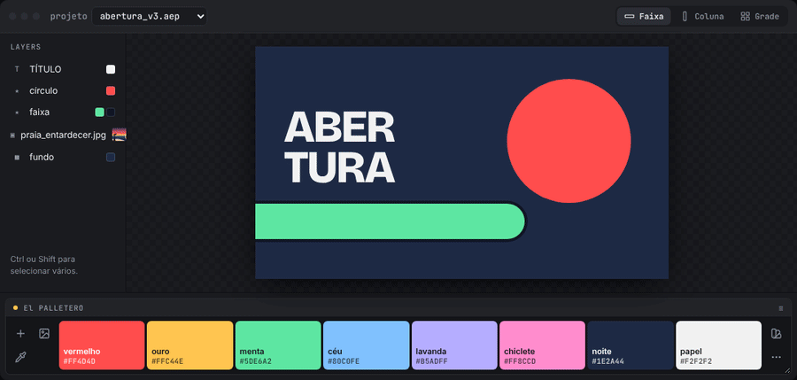
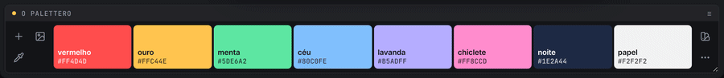
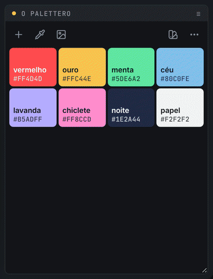
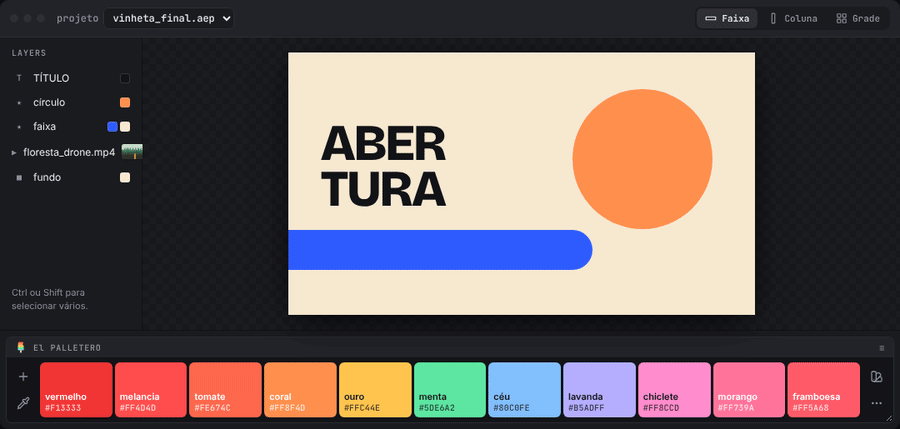
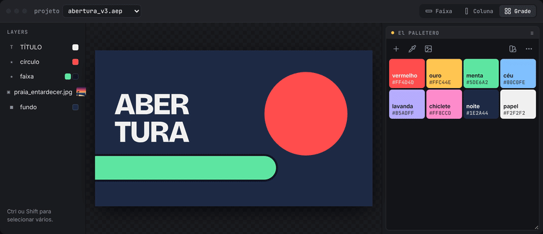
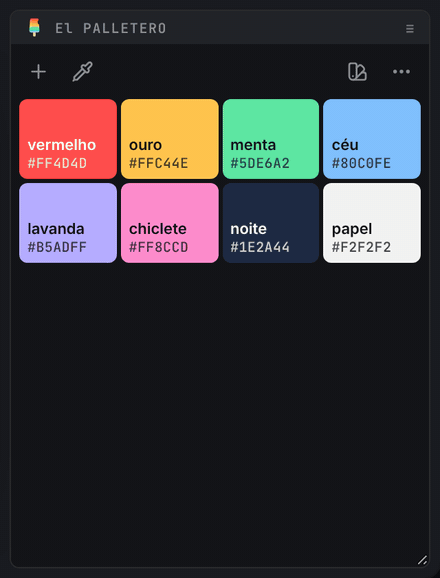
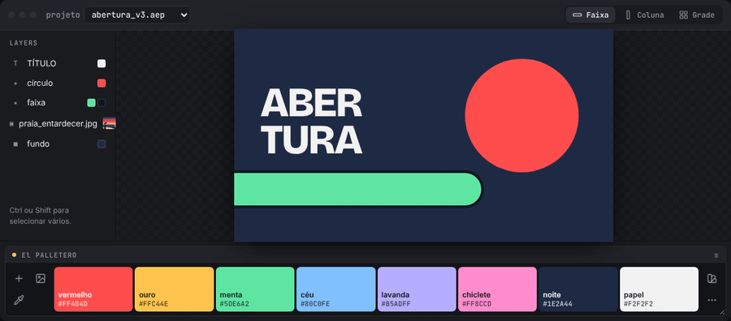

# 🎨 O PALETTERO · v1.1 beta

🗨️ **pt-BR** ⚡ a paleta de cores do projeto, como painel do After Effects ⚡

o paletero guarda as cores do projeto num painel que você acopla em qualquer lugar da interface. um clique aplica a cor nos layers selecionados. as cores podem vir do seletor, dos layers, do projeto inteiro, de uma imagem ou de uma biblioteca de presets compartilhada pela equipe.

> 

> 🧪 *quer experimentar sem instalar?* baixe [`mockup/O-PALETTERO-mockup.html`](mockup/O-PALETTERO-mockup.html) e abra no navegador: é o mesmo código do painel, ligado a uma composição de mentira. todos os GIFs desta página foram gravados nele.

<br>

## 📍 sumário

- [instalação](#-instalação)
- [aplicar cores](#-aplicar-cores)
- [organizar a paleta](#-organizar-a-paleta)
- [editor de cor e nomes automáticos](#-editor-de-cor-e-nomes-automáticos)
- [capturar cores do projeto](#-capturar-cores-do-projeto)
- [extrair cores de uma imagem](#-extrair-cores-de-uma-imagem)
- [presets](#-presets)
- [formatos do painel](#-formatos-do-painel)
- [ajustes](#-ajustes)
- [teclado e atalhos](#-teclado-e-atalhos)
- [desenvolvimento](#-desenvolvimento)
- [script clássico](#-script-clássico)

<br>

---

<br>

## 📍 instalação

requer After Effects **2022 (22.0)** ou mais novo, no Windows ou no macOS.

1. copie a pasta `cep/com.jmbillard.opalettero` para a pasta de extensões:
   - **Windows:** `%APPDATA%\Adobe\CEP\extensions\` (só o seu usuário) ou `C:\Program Files (x86)\Common Files\Adobe\CEP\extensions\` (todos)
   - **macOS:** `~/Library/Application Support/Adobe/CEP/extensions/` ou `/Library/Application Support/Adobe/CEP/extensions/`
2. libere extensões sem assinatura (uma vez só):
   - **Windows:** `reg add HKCU\Software\Adobe\CSXS.11 /v PlayerDebugMode /t REG_SZ /d 1 /f` (repita com `CSXS.12` para o AE 2025 ou mais novo)
   - **macOS:** `defaults write com.adobe.CSXS.11 PlayerDebugMode 1` (repita com `com.adobe.CSXS.12`)
3. **reinicie** o After Effects.
4. abra o painel em `Window` > `Extensions` > `O PALETTERO` e acople onde preferir.

> 🚩 *obs:*\
> • no macOS, se o painel não aparecer, rode `killall cfprefsd` no Terminal (o sistema guarda as preferências em cache) e abra o After Effects de novo.\
> • as preferências ficam em `%APPDATA%\O PALETTERO script\` (Windows) ou `~/Library/Application Support/O PALETTERO script/` (macOS), o mesmo lugar do script clássico.

<br>

---

<br>

## 📍 aplicar cores

1. selecione os layers (ou as propriedades de cor) na composição.
2. `◖ clique esquerdo` na cor.

- com **propriedades de cor selecionadas** (Fill, Stroke, Tint, a cor de um efeito, o Source Text…), só elas mudam.
- sem propriedades selecionadas, cada layer ganha um efeito **Fill** com o nome da cor (`#FF4D4D`). aplicar outra cor **reaproveita** esse Fill em vez de empilhar outro.
- com keyframes, a cor entra no tempo atual.
- a última cor aplicada ganha um pontinho e passa a ser a cor de destaque do painel.

> 🚩 *obs:*\
> • cada aplicação é **um passo** de desfazer no After Effects (`O PALETTERO · aplicar #HEX`).\
> • sem nada selecionado, a amostra balança e o aviso explica o que falta.

<br>

---

<br>

## 📍 organizar a paleta

> 

- **arrastar** → reordena. os vizinhos abrem espaço enquanto você arrasta.
- `Ctrl` / `⌘` + `◖ clique` → copia o valor da cor (HEX, RGB ou HSB, conforme os ajustes).
- segure `Alt` / `⌥` → **modo excluir**: as amostras tremem e mostram um ×. clique para remover.
- `◗ clique direito` ou o ✏️ (aparece ao passar o mouse) → editor de cor.

> 🚩 *obs:*\
> • toda mudança na paleta tem **desfazer**: o botão no aviso ou `Ctrl+Z` / `⌘Z` com o painel em foco.\
> • a paleta é salva no projeto na hora. não existe botão de salvar.

<br>

---

<br>

## 📍 editor de cor e nomes automáticos

o editor nasce da própria amostra e volta para ela quando você confirma.

> 

- **quadrado** → saturação e brilho. **faixa colorida** → matiz. com o mouse ou com as setas do teclado (`Shift` anda mais rápido).
- **campo de valor** → digite ou cole a cor. o botão `HEX` alterna para `RGB` e `HSB`. colar em qualquer lugar do editor também funciona (`#ff4d4d`, `rgb(255, 77, 77)`, `0 70 100`…).
- **metade esquerda da prévia** → a cor original. `◖ clique` volta para ela.
- `Enter` confirma, `Esc` cancela. o 🗑️ exclui a cor.

### nomes automáticos

cada cor ganha um nome em português, do mundo real: *menta*, *tijolo*, *céu*, *mostarda*, *berinjela*, *noite*…

- o nome é o da cor de referência mais próxima (são cerca de 150, comparadas em CIELAB, que mede diferença de cor como o olho).
- se o nome já existe na paleta, entra um vizinho parecido (*vermelho* → *melancia*) ou *suave* / *forte*.
- no editor, o nome automático (em itálico, com ✦ preenchido) **acompanha a cor** enquanto você mexe.
- digitou um nome seu? ele fica fixo. o ✦ devolve o automático.

> 🚩 *obs:*\
> • nomes antigos como `cor 3`, vazios ou iguais ao hex viram automáticos.\
> • para ver os nomes nas amostras, ligue **mostrar nomes** nos [ajustes](#-ajustes).

<br>

---

<br>

## 📍 capturar cores do projeto

o **conta-gotas** (doca da esquerda) traz para a paleta as cores que já estão no projeto.

> 

- `◖ clique esquerdo` → cores da **seleção**: primeiro das propriedades selecionadas; sem propriedades, dos layers selecionados inteiros (efeitos, shapes, textos, sólidos).
- `Shift` + `◖ clique esquerdo` → cores do **projeto inteiro**. com `Shift` pressionado, o ícone vira as camadas.

> 🚩 *obs:*\
> • só entram cores que ainda não estão na paleta, e já chegam com nome.\
> • o vermelho padrão de efeitos que nunca foram alterados (`#FF0000`) é ignorado.

<br>

---

<br>

## 📍 extrair cores de uma imagem

o botão de **imagem** (doca da esquerda) lê o frame atual do layer selecionado e sugere as cores principais.

> 

- funciona com **imagem**, **vídeo**, **PSD** e **precomp**. sem layer com imagem, usa o frame atual da **composição**.
- os marcadores na imagem mostram de onde veio cada cor. passe o mouse numa amostra para destacar o marcador.
- `◖ clique` numa amostra → liga / desliga.
- `−` / `+` → menos ou mais cores (de 2 a 12; o painel lembra a sua escolha).
- `◖ clique` na imagem → adiciona a cor daquele ponto (a lupa mostra a cor antes do clique).
- ✓ ou `Enter` → adiciona as cores ligadas à paleta.

> 🚩 *obs:*\
> • as cores são agrupadas por **k-means em CIELAB**, e o painel escolhe grupos bem diferentes entre si. a mesma imagem sempre dá o mesmo resultado.\
> • vídeos e precomps precisam ser renderizados. se demorar, aparece *renderizando frame · Ns*. `Esc` cancela.\
> • o painel só lê o frame depois que o arquivo foi gravado por completo, e apaga os temporários no final.

<br>

---

<br>

## 📍 presets

a paleta do projeto mora no `.aep`. os **presets** são uma biblioteca de paletas numa pasta que você escolhe, que pode ser uma pasta de rede da equipe.

> 

- `◖ clique` num preset → **substitui** a paleta do projeto.
- `Shift` + `◖ clique` → **adiciona** as cores que faltam.
- **salvar preset** → a paleta do projeto vira um preset novo.
- ✏️ renomeia, ★ define o preset usado em projetos sem paleta, 🗑️ exclui.

a pasta de presets entende caminhos de rede do Windows e do Mac, volumes montados de novo (`VFX-1`) e volumes desmontados → [documentação completa](docs/presets.md).

<br>

---

<br>

## 📍 formatos do painel

o painel se reorganiza sozinho conforme o tamanho:

> 

| formato | quando | como fica |
| --- | --- | --- |
| **faixa** | largo e baixo | amostras lado a lado; a amostra sob o mouse cresce |
| **lista** | estreito e alto | uma cor por linha, com nome e valor |
| **grade** | espaçoso | blocos quadrados; o editor e a extração ganham espaço |

<br>

---

<br>

## 📍 ajustes

o **⋯** (doca da direita) abre os ajustes no lugar das cores.

- **HEX · RGB · HSB** → formato dos valores nas amostras e do que é copiado.
- 👁 **valores sempre visíveis** → mostra os valores sem precisar passar o mouse (quando cabem).
- 🏷 **mostrar nomes** → mostra o nome da cor nas amostras.
- ⇅ **ordenar por matiz** → matiz → luminosidade → saturação, cinzas no fim.
- 🗑 **segure para limpar** → segure o botão até a barra encher para esvaziar a paleta (tem desfazer).
- **?** → esta documentação.

<br>

---

<br>

## 📍 teclado e atalhos

| ação | Windows | macOS |
| --- | --- | --- |
| aplicar | `◖ clique` | `◖ clique` |
| editar | `◗ clique direito` | `◗ clique direito` ou `Ctrl` + `◖ clique` |
| copiar valor | `Ctrl` + `◖ clique` | `⌘` + `◖ clique` |
| excluir | `Alt` + `◖ clique` | `⌥` + `◖ clique` |
| capturar do projeto inteiro | `Shift` + conta-gotas | `⇧` + conta-gotas |
| adicionar preset sem substituir | `Shift` + `◖ clique` no preset | `⇧` + `◖ clique` no preset |
| desfazer (paleta) | `Ctrl+Z` | `⌘Z` |
| confirmar / cancelar (editor, extração) | `Enter` / `Esc` | `Return` / `Esc` |
| amostra em foco: aplicar · editar · excluir | `Enter` · `F2` · `Delete` | `Return` · `F2` · `Delete` |

> 🚩 *obs:*\
> • com o painel em foco, ele pede essas teclas ao After Effects, para `Ctrl+Z` / `⌘Z` desfazer a paleta, e não o projeto, e `Delete` não apagar layers.\
> • as dicas do painel aparecem quando o mouse pode fazer alguma coisa e mudam ao vivo quando você segura `Ctrl`, `Alt` ou `Shift`. as dicas das amostras somem depois que você já as viu algumas vezes.

<br>

---

<br>

## 📍 desenvolvimento

```text
cep/com.jmbillard.opalettero/
├── CSXS/manifest.xml   → registro da extensão (AEFT 22+)
├── index.html          → painel
├── css/panel.css       → visual e animações
├── js/color.js         → conversões de cor (HSB, CIELAB…)
├── js/names.js         → nomes automáticos
├── js/extract.js       → extração de cores (k-means em CIELAB)
├── js/bridge.js        → ponte painel ↔ ExtendScript (ou o mock, no navegador)
├── js/panel.js         → estado, interações e animações
└── jsx/host.jsx        → lado After Effects: metadados, presets, rede, aplicar, capturar, frames
mockup/                 → página de demonstração com um "After Effects de mentira"
tools/                  → scripts que geram o mockup e os GIFs desta documentação
```

- **depurar:** com o painel aberto, acesse `http://localhost:8099` no Chrome.
- **mockup:** depois de mudar o painel, rode `node tools/build-mockup.js`.
- **GIFs:** `node tools/gifs/record.js` grava todos de novo a partir do mockup (ou `node tools/gifs/record.js editor presets` para alguns). precisa do Playwright e do `ffmpeg`.

> 🚩 *obs:*\
> • o painel usa o Node.js do CEP (`--enable-nodejs`) só para ler o PNG do frame.\
> • o frame é gerado com `saveFrameToPng`, um método que existe no After Effects mas não está na documentação oficial.

<br>

---

<br>

## 📍 script clássico

a versão original em ScriptUI (`O PALETEIRO beta.jsx`) continua no repositório → [documentação do script clássico](docs/script-classico.md).

> 🚩 *obs:*\
> • a extensão lê as paletas salvas pelo script e migra para o formato novo. o script não lê as paletas salvas pela extensão.
