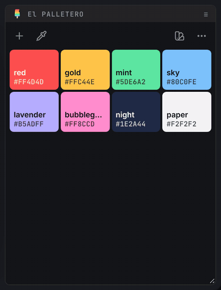
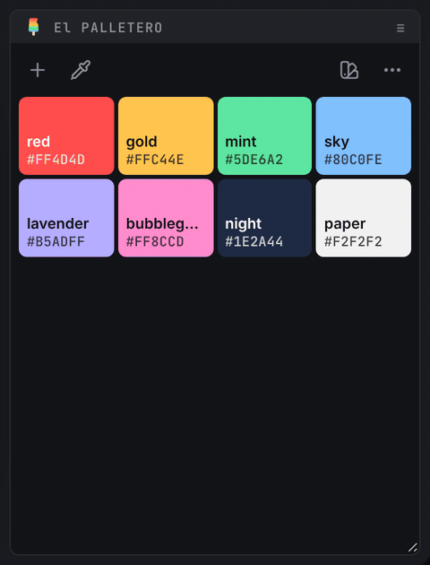

# 📚 presets and network folders

[← El PALLETERO](../README.en.md) · 🗨️ [português](presets.md) · **English** · [español](presets.es.md)

The **project palette** and the **presets** are separate things:

| | where it lives | who sees it |
| --- | --- | --- |
| **project palette** | inside the `.aep`, in its own metadata group | whoever opens the project |
| **presets** | `.json` files in a folder you choose | whoever has access to the folder (it can be the team's network folder) |

The panel always shows the project palette. Presets are a library for bringing colors into it.

 

---

 

## 📍 the library

`◖ left-click` the **presets** icon (right dock) to open the library in place of the colors. The icon turns into **×** to close it (or `Esc`).

> 📟 *using, mixing and saving presets:*
>
> 

- **first card** (colored border) → this project's palette, with the `.aep` name (or *untitled*). Hover to see what a click does:
  - **not saved** (it didn't come from a preset, or it changed since) → a thin line sets the card apart from the presets. `◖ click` saves it as a new preset and opens the name for editing right away (`Enter` confirms, `Esc` keeps the suggested name).
  - **changed since its source preset** → `Shift` + `◖ click` **updates** that preset with the project palette (it can be undone). The source preset's dot becomes hollow.
  - **saved** (same as its source preset) → hovering just confirms where it is.
- **preset card**:
  - `◖ left-click` → **replaces** the project palette with the preset.
  - `Shift` + `◖ left-click` → **adds** to the project only the preset colors that aren't there yet.
  - ✏️ → rename (or `F2`).
  - ★ → **default** preset: the one shown in projects that don't have a palette yet.
  - 🗑️ → delete (or `Delete`).
  - **reorder** from the empty area to the right of the name (the ⠿ handle shows on hover):
    - `◖ click` the handle → picks up the preset; it follows the mouse; `◖ click` again → drops it. `Esc` cancels. Works even when the first click only activates the panel.
    - or drag with the button held down (with the panel already focused).
    - with the handle focused, ↑ ↓ (← → in the strip) also change the order. The order is stored in your preferences, per folder: in a team folder each person has their own order and the files don't change.
- The colored dot in the card's corner marks the preset the project palette came from.

> 🚩 *notes:*\
> • The example presets come in After Effects' language the first time. Examples you deleted don't come back in new versions.\
> • Everything can be **undone**: the message at the bottom has the button, and `Ctrl+Z` / `⌘Z` works too (even to bring back a deleted preset).\
> • In the strip (short panel) the library scrolls sideways with the mouse wheel.

 

---

 

## 📍 the presets folder

The **folder** button (at the end of the library) shows where the presets are.

- `◖ left-click` → choose another folder.
- `Alt` / `⌥` + `◖ left-click` → open the folder in Explorer / Finder.

Each preset is a `.json` file (UTF-8, file name with plain letters only), so the same folder works on Windows and Mac, and two people saving at the same time don't get in each other's way.

| | Windows | macOS |
| --- | --- | --- |
| default folder | `%APPDATA%\El PALLETERO\presets` | `~/Library/Application Support/El PALLETERO/presets` |
| network folder | UNC path (`\\server\palettes`) or mapped drive (`L:\palettes`) | mounted volume (`/Volumes/palettes`) |

 

---

 

## 📍 network folders across Windows and Mac

The same network folder has different paths on each system, and even on the same Mac the path changes when the volume is mounted again (`/Volumes/VFX` → `/Volumes/VFX-1`). The panel sorts this out on its own:

1. When you **choose** the folder, the panel stores this machine's path and a **neutral network form**: `//server/share/folder`.
   - On **Windows**, the drive letter is translated by reading `net use` (`L:\palettes` → `//server/VFX/image/drive_l/palettes`).
   - On **Mac**, the volume is translated by reading `mount` (`/Volumes/VFX-1/palettes` → `//server/VFX/palettes`).
2. When **opening**, the neutral form becomes the path that exists now:
   - On **Windows** → the drive letter, if one is mapped to the share; otherwise the UNC path.
   - On **Mac** → the volume mounted with that server and share. This also covers subfolders mounted as volumes, names with spaces and the server's short (`vfx-ml-sp`) or full name (`vfx-ml-sp.services…`). Servers given by IP (`10.0.0.5`) must match exactly.
3. If the share was mounted again as `VFX-1` … `VFX-5`, the panel finds the right variant.

> 🚩 *notes:*\
> • The volume logic comes from [O PADEIRO](https://github.com/jmbillard/O-PADEIRO). The difference is that here the server ↔ drive ↔ volume map is **discovered on the fly**, with no fixed list of servers.\
> • On Windows, `net use` runs at most once per After Effects session, and only when a drive letter has to be translated.

### unmounted volume

If the volume isn't mounted (or the drive is disconnected), the panel **creates nothing** in its place. The library shows a message with the ways out:

> 📟 *unmounted network volume:*
>
> 

- **Mount** (Mac only) → asks the Finder to mount the share. If a password is needed, the system itself asks.
- **↻** → try again.
- **folder** → go back to the local default folder.

The panel also tries again on its own when it gets focus back.

 

---

 

## 📍 the project metadata

The project palette lives in the `.aep`, in its own XMP metadata group:

| | |
| --- | --- |
| namespace | `https://github.com/jmbillard/El-PALLETERO/ns/1.0/` |
| `palette` | the list of colors, as JSON text (`color`, `label`, `auto`) |
| `preset` | the name of the preset the palette came from (if any) |
| `version` · `updated` | format version and date of the last save |

> 🚩 *notes:*\
> • Projects with a palette from the old O PALETTERO script (`xmp:Label`) or from the extension with the old name (namespace `…/O-PALETTERO/ns/1.0/`) are read normally and migrate to the new group on the first save.\
> • Automatic names are marked with `auto: true`: that's why they keep following the color when you edit it.\
> • After Effects' **Metadata** panel doesn't show this group (it only lists the groups it knows), but it is in the file. The panel writes to the open project right away; the `.aep` on disk changes when you save the project.\
> • The palette is read as data only (JSON): a project received from someone else can't run anything through the panel.
