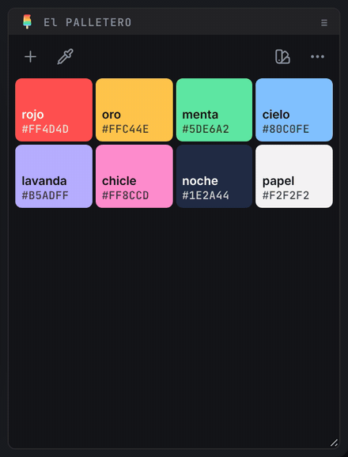

# 📚 presets y carpetas de red

[← El PALLETERO](../README.es.md) · 🗨️ [português](presets.md) · [English](presets.en.md) · **español**

La **paleta del proyecto** y los **presets** son cosas distintas:

| | dónde está | quién la ve |
| --- | --- | --- |
| **paleta del proyecto** | dentro del `.aep`, en un grupo de metadatos propio | quien abra el proyecto |
| **presets** | archivos `.json` en una carpeta que tú eliges | quien tenga acceso a la carpeta (puede ser una carpeta de red del equipo) |

El panel siempre muestra la paleta del proyecto. Los presets son una biblioteca para traer colores a ella.

 

---

 

## 📍 la biblioteca

`◖ clic izquierdo` en el icono de **presets** (base derecha) abre la biblioteca en lugar de los colores. El icono se convierte en **×** para cerrar (o `Esc`).

> 📟 *usar, combinar y guardar presets:*
>
> 

- **primera tarjeta** (borde de color) → la paleta de este proyecto, con el nombre del `.aep` (o *sin título*). Pasa el ratón para ver lo que hace el clic:
  - **sin guardar** (no vino de un preset, o cambió desde entonces) → una línea separa la tarjeta de los presets. `◖ clic` la guarda como un preset nuevo y abre el nombre para editarlo (`Enter` confirma, `Esc` mantiene el nombre sugerido).
  - **cambió desde su preset de origen** → `Shift` + `◖ clic` **actualiza** ese preset con la paleta del proyecto (se puede deshacer). El puntito del preset de origen queda hueco.
  - **guardada** (igual a su preset de origen) → al pasar el ratón solo confirma dónde está.
- **tarjeta de preset**:
  - `◖ clic izquierdo` → **reemplaza** la paleta del proyecto por el preset.
  - `Shift` + `◖ clic izquierdo` → **añade** al proyecto solo los colores del preset que aún no están.
  - ✏️ → renombrar (o `F2`).
  - ★ → preset **predeterminado**: el que aparece en proyectos que aún no tienen paleta.
  - 🗑️ → eliminar (o `Delete`).
  - **reordenar** desde el área vacía a la derecha del nombre (el asa ⠿ aparece al pasar el ratón):
    - `◖ clic` en el asa → toma el preset; sigue al ratón; `◖ clic` otra vez → lo suelta. `Esc` cancela. Funciona incluso cuando el primer clic solo activa el panel.
    - o arrastra con el botón pulsado (con el panel ya en foco).
    - con el asa en foco, ↑ ↓ (← → en la franja) también cambian el orden. El orden se guarda en tus preferencias, por carpeta: en una carpeta de equipo cada persona tiene su orden y los archivos no cambian.
- El puntito de color en la esquina de la tarjeta marca el preset del que vino la paleta del proyecto.

> 🚩 *notas:*\
> • Los presets de ejemplo vienen en el idioma de After Effects la primera vez. Los ejemplos que borraste no vuelven en versiones nuevas.\
> • Todo se puede **deshacer**: el aviso de abajo tiene el botón, y `Ctrl+Z` / `⌘Z` también funciona (incluso para recuperar un preset eliminado).\
> • En la franja (panel bajo) la biblioteca se desplaza en horizontal con la rueda del ratón.

 

---

 

## 📍 la carpeta de presets

El botón de **carpeta** (al final de la biblioteca) muestra dónde están los presets.

- `◖ clic izquierdo` → elegir otra carpeta.
- `Alt` / `⌥` + `◖ clic izquierdo` → abrir la carpeta en el Explorador / Finder.

Cada preset es un archivo `.json` (UTF-8, nombre de archivo solo con letras sin acentos), así que la misma carpeta funciona en Windows y en Mac, y dos personas guardando a la vez no se estorban.

| | Windows | macOS |
| --- | --- | --- |
| carpeta predeterminada | `%APPDATA%\El PALLETERO\presets` | `~/Library/Application Support/El PALLETERO/presets` |
| carpeta de red | ruta UNC (`\\servidor\paletas`) o unidad asignada (`L:\paletas`) | volumen montado (`/Volumes/paletas`) |

 

---

 

## 📍 carpetas de red entre Windows y Mac

La misma carpeta de red tiene rutas distintas en cada sistema, e incluso en el mismo Mac la ruta cambia cuando el volumen se vuelve a montar (`/Volumes/VFX` → `/Volumes/VFX-1`). El panel lo resuelve solo:

1. Al **elegir** la carpeta, el panel guarda la ruta de esta máquina y una **forma neutra de red**: `//servidor/share/carpeta`.
   - En **Windows**, la letra de unidad se traduce leyendo `net use` (`L:\paletas` → `//servidor/VFX/imagen/drive_l/paletas`).
   - En **Mac**, el volumen se traduce leyendo `mount` (`/Volumes/VFX-1/paletas` → `//servidor/VFX/paletas`).
2. Al **abrir**, la forma neutra se convierte en la ruta que existe ahora:
   - En **Windows** → la letra de unidad, si hay una asignada al share; si no, la ruta UNC.
   - En **Mac** → el volumen montado con ese servidor y share. También vale para subcarpetas montadas como volumen, nombres con espacios y el servidor con nombre corto (`vfx-ml-sp`) o completo (`vfx-ml-sp.servicios…`). Los servidores por IP (`10.0.0.5`) tienen que coincidir completos.
3. Si el share se volvió a montar como `VFX-1` … `VFX-5`, el panel encuentra la variante correcta.

> 🚩 *notas:*\
> • La lógica de volúmenes viene de [O PADEIRO](https://github.com/jmbillard/O-PADEIRO). La diferencia es que aquí el mapa servidor ↔ unidad ↔ volumen se **descubre al momento**, sin lista fija de servidores.\
> • En Windows, `net use` se ejecuta como mucho una vez por sesión de After Effects, y solo cuando hay que traducir una letra de unidad.

### volumen desmontado

Si el volumen no está montado (o la unidad está desconectada), el panel **no crea nada** en su lugar. La biblioteca muestra un aviso con las salidas:

> 📟 *volumen de red desmontado:*
>
> 

- **Montar** (solo en Mac) → pide al Finder que monte el share. Si hace falta contraseña, el propio sistema la pide.
- **↻** → reintentar.
- **carpeta** → volver a la carpeta local predeterminada.

El panel también lo vuelve a intentar solo cuando recupera el foco.

 

---

 

## 📍 los metadatos del proyecto

La paleta del proyecto está en el `.aep`, en un grupo de metadatos XMP propio:

| | |
| --- | --- |
| namespace | `https://github.com/jmbillard/El-PALLETERO/ns/1.0/` |
| `palette` | la lista de colores, como texto JSON (`color`, `label`, `auto`) |
| `preset` | el nombre del preset del que vino la paleta (si lo hay) |
| `version` · `updated` | versión del formato y fecha del último guardado |

> 🚩 *notas:*\
> • Los proyectos con paleta del antiguo script O PALETTERO (`xmp:Label`) o de la extensión con el nombre antiguo (namespace `…/O-PALETTERO/ns/1.0/`) se leen normalmente y migran al grupo nuevo al guardar por primera vez.\
> • Los nombres automáticos quedan marcados con `auto: true`: por eso siguen al color cuando lo editas.\
> • El panel **Metadata** de After Effects no muestra este grupo (solo lista los grupos que conoce), pero está en el archivo. El panel escribe al momento en el proyecto abierto; el `.aep` en disco cambia cuando guardas el proyecto.\
> • La paleta se lee solo como datos (JSON): un proyecto recibido de otra persona no puede ejecutar nada a través del panel.
