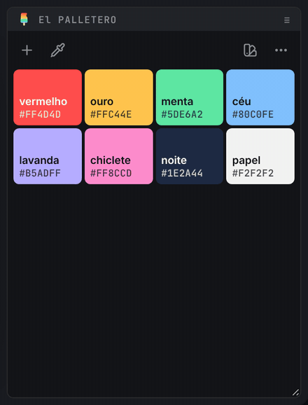
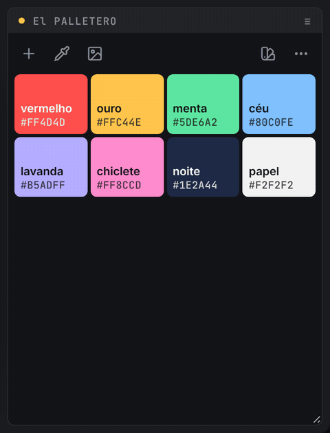

# 📚 presets e pastas de rede

[← O PALETTERO](../README.md)

a **paleta do projeto** e os **presets** são coisas separadas:

| | onde fica | quem vê |
| --- | --- | --- |
| **paleta do projeto** | dentro do `.aep`, num grupo de metadados próprio | quem abrir o projeto |
| **presets** | arquivos `.json` numa pasta que você escolhe | quem tiver acesso à pasta (dá para usar uma pasta de rede da equipe) |

o painel sempre mostra a paleta do projeto. os presets são uma biblioteca para trazer cores para ela.

 

---

 

## 📍 a biblioteca

`◖ clique esquerdo` no ícone de **presets** (na doca da direita) abre a biblioteca no lugar das cores. o ícone vira **×** para fechar (ou `Esc`).

> 📟 *usar, misturar e salvar presets:*
>
> 

- **primeiro cartão** (borda colorida) → a paleta deste projeto, com o nome do `.aep`.
- **salvar preset** → salva a paleta do projeto como um preset novo e já abre o nome para edição. `Enter` confirma, `Esc` mantém o nome sugerido.
- **cartão de preset**:
  - `◖ clique esquerdo` → **substitui** a paleta do projeto pelo preset.
  - `Shift` + `◖ clique esquerdo` → **adiciona** ao projeto só as cores do preset que ainda não estão lá.
  - ✏️ → renomear (ou `F2`).
  - ★ → preset **padrão**: é o que aparece em projetos que ainda não têm paleta.
  - 🗑️ → excluir (ou `Delete`).
- o pontinho colorido no canto do cartão marca o preset de onde a paleta do projeto veio.

> 🚩 *obs:*\
> • tudo tem **desfazer**: o aviso que aparece embaixo tem o botão, e `Ctrl+Z` / `⌘Z` também funciona (inclusive para trazer de volta um preset excluído).\
> • na faixa (painel baixo) a biblioteca rola na horizontal, com a roda do mouse.

 

---

 

## 📍 a pasta de presets

o botão de **pasta** (no fim da biblioteca) mostra onde os presets estão.

- `◖ clique esquerdo` → escolher outra pasta.
- `Alt` / `⌥` + `◖ clique esquerdo` → abrir a pasta no Explorer / Finder.

cada preset é um arquivo `.json` (UTF-8, nome do arquivo só com letras sem acento), então a mesma pasta funciona no Windows e no Mac, e duas pessoas salvando ao mesmo tempo não se atrapalham.

| | Windows | macOS |
| --- | --- | --- |
| pasta padrão | `%APPDATA%\O PALETTERO script\presets` | `~/Library/Application Support/O PALETTERO script/presets` |
| pasta de rede | caminho UNC (`\\servidor\paletas`) ou unidade mapeada (`L:\paletas`) | volume montado (`/Volumes/paletas`) |

 

---

 

## 📍 pastas de rede entre Windows e Mac

a mesma pasta de rede tem caminhos diferentes em cada sistema, e até no mesmo Mac o caminho muda quando o volume é montado de novo (`/Volumes/VFX` → `/Volumes/VFX-1`). o painel resolve isso sozinho:

1. ao **escolher** a pasta, o painel guarda o caminho desta máquina e uma **forma neutra de rede**: `//servidor/share/pasta`.
   - no **Windows**, a letra de unidade é traduzida lendo o `net use` (`L:\paletas` → `//servidor/VFX/imagem/drive_l/paletas`).
   - no **Mac**, o volume é traduzido lendo o `mount` (`/Volumes/VFX-1/paletas` → `//servidor/VFX/paletas`).
2. ao **abrir**, a forma neutra vira o caminho que existe agora:
   - no **Windows** → a letra de unidade, se houver uma mapeada para o share; senão, o caminho UNC.
   - no **Mac** → o volume montado com aquele servidor e share. vale também para subpastas montadas como volume, nomes com espaço e o servidor com nome curto (`vfx-ml-sp`) ou completo (`vfx-ml-sp.servicos…`).
3. se o share foi montado de novo como `VFX-1` … `VFX-5`, o painel acha a variante certa.

> 🚩 *obs:*\
> • a lógica de volumes vem do [O PADEIRO](https://github.com/jmbillard/O-PADEIRO). a diferença é que aqui o mapa servidor ↔ unidade ↔ volume é **descoberto na hora**, sem lista fixa de servidores.\
> • no Windows, o `net use` roda no máximo uma vez por sessão do After Effects, e só quando é preciso traduzir uma letra de unidade.

### volume desmontado

se o volume não estiver montado (ou a unidade estiver desconectada), o painel **não cria nada** no lugar. a biblioteca mostra um aviso com as saídas:

> 📟 *volume de rede desmontado:*
>
> 

- **Montar** (só no Mac) → pede ao Finder para montar o share. se precisar de senha, o próprio sistema pergunta.
- **↻** → tentar de novo.
- **pasta** → voltar para a pasta local padrão.

o painel também tenta de novo sozinho quando volta a ter foco.

 

---

 

## 📍 os metadados do projeto

a paleta do projeto fica no `.aep`, num grupo de metadados XMP próprio:

| | |
| --- | --- |
| namespace | `https://github.com/jmbillard/O-PALETTERO/ns/1.0/` |
| `palette` | a lista de cores (`color`, `label`, `auto`) |
| `preset` | o nome do preset de onde a paleta veio (se houver) |
| `version` · `updated` | versão do formato e data do último salvamento |

> 🚩 *obs:*\
> • projetos com paleta do [script clássico](script-classico.md) (`xmp:Label`) são lidos normalmente e migram para o grupo novo no primeiro salvamento.\
> • nomes automáticos ficam marcados com `auto: true`: por isso continuam acompanhando a cor quando você a edita.
